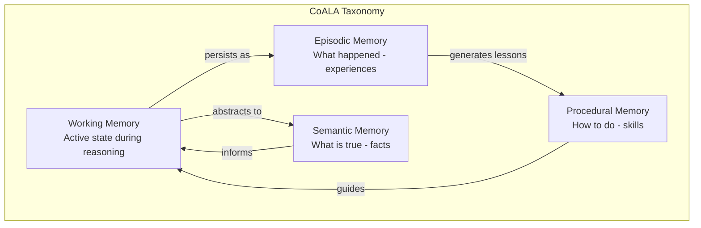
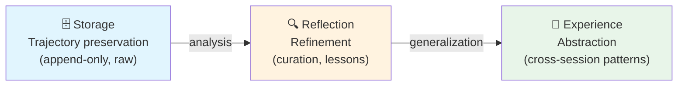

# Memory Systems — Fundamental Concepts

> **Based on:** CoALA (arXiv:2309.02427, TMLR 2024), Storage→Experience survey (arXiv:2605.06716), The Memory Curse (arXiv:2605.08060), MemMachine (arXiv:2604.04853), Anthropic Dreaming (May 2026)

---

## 1. The Fundamental Problem

A code agent without memory repeats mistakes, forgets decisions, and loses lessons from sub-agents. Every session starts from scratch — the agent that worked 2 hours on your project yesterday doesn't remember anything today.

The challenge is not storing everything — it's **what to keep** and **how to retrieve** without polluting the context window, which is a finite resource managed by the Context Engine.

### Empirical Data

| Source | Finding |
|---|---|
| "The Memory Curse" (arXiv:2605.08060, 2026) | Expanding accessible history **DEGRADES** cooperation in 18/28 model-game combinations. The trigger is the **content** of memory, not the size. |
| Anthropic Dreaming (production, May 2026) | Dream consolidation: **6x improvement** in task completion (Harvey). Scheduled review + merge + automatic prune. |
| Factory.ai (2026) | Artifact tracking is universally weak (2.19–2.45/5.0) — information about "which files the agent touched" is lost in compaction. |
| MemMachine (arXiv:2604.04853, 2026) | Summary-only loses factual detail. **Raw episodes + summaries > summaries-only**. SOTA LoCoMo: 0.9169. |
| Anthropic Harness Research (2025) | `claude-progress.txt` (episodic) + `feature_list.json` (semantic) + `init.sh` (procedural) = minimum viable taxonomy in production. |

**Central principle:** high-quality memory with controlled recall surpasses voluminous memory with indiscriminate recall.

---

## 2. Cognitive Analogy

A code agent's memory mirrors human cognition:

```
┌──────────────────────────────────────────────────────┐
│                   HUMAN MEMORY                        │
│                                                       │
│  ┌─────────────┐   ┌─────────────┐   ┌────────────┐ │
│  │ Short-Term   │   │  Working    │   │ Long-Term  │ │
│  │ Memory (STM) │──►│  Memory    │◄──│ Memory     │ │
│  │              │   │  (WM)      │   │ (LTM)      │ │
│  │ ~7 items     │   │ work       │   │ bookshelf  │ │
│  │ seconds      │   │ desk       │   │            │ │
│  └─────────────┘   └─────────────┘   └────────────┘ │
└──────────────────────────────────────────────────────┘
```

| Cognitive Component | Agent Equivalent | Characteristic |
|---|---|---|
| **Short-Term Memory (STM)** | Context window (recent turns) | Ephemeral, limited, FIFO |
| **Working Memory (WM)** | Active state (task, subgoals, errors) | Structured, mutable during reasoning |
| **Long-Term Memory (LTM)** | Memory store (persistent files) | Durable, cross-session, requires recall |

**The critical boundary:** STM and WM live in the Context Engine (ephemeral). LTM lives in the Memory domain (durable). The architectural challenge is the **bridge** — how to bring durable knowledge to the working desk without overloading it.

---

## 3. Taxonomy: CoALA and the 4 Categories

### 3.1 CoALA Taxonomy (TMLR 2024)

The CoALA framework (Cognitive Architectures for Language Agents, arXiv:2309.02427) defines 4 memory types for agents:



### 3.2 The 4 Categories of Knowledge for Code Agents

Based on the CoALA taxonomy and validated against 12 production implementations:

| Type | What it stores | Example | Duration |
|---|---|---|---|
| **Procedural** | How to do something in this project | "Use `make test-unit` for tests, `cargo clippy` before commit" | Permanent |
| **Semantic** | Domain facts and relationships | "The billing module depends on payment-gateway due to the Stripe integration" | Permanent |
| **Failure Heuristic** | Errors already made and how to avoid them | "Redis timeout happens when >1000 keys in the pipeline — use chunking" | Decays if not confirmed |
| **Subagent Lesson** | What sub-agents discovered | "Refactor sub-agent: trait Foo is not object-safe, use enum dispatch" | Permanent |

**Failure heuristics have disproportionate value:** the ERL paper (arXiv:2603.24639) demonstrates that failure lessons outperform success lessons by +14.3% on search tasks. The agent learns more from what went wrong.

### 3.3 Evolutionary Taxonomy: Storage → Reflection → Experience

More recent research (arXiv:2605.06716, May 2026) proposes 3 evolutionary stages of maturity:



| Stage | What it does | Example in practice |
|---|---|---|
| **Storage** | Records everything that happened (trajectories, tool results) | Session logs, JSONL append-only |
| **Reflection** | Refines and curates — extracts lessons, discards noise | Explicit `store_memory`, failure heuristics |
| **Experience** | Abstracts patterns that transcend individual sessions | Dream consolidation, cross-session patterns |

**Current state of the art:** most production implementations are in the **Reflection** stage. The Experience stage is emerging (Anthropic Dreaming is the first production case).

---

## 4. Fundamental Invariants

Rules that can **never** be violated in a SOTA memory system:

### 4.1 Memory ↔ Context Separation

```
Memory ──recall blocks──► Context ──► LLM Prompt
Memory ◄────── NEVER ──── Context
```

- Memory offers **recall blocks** that the Context Engine decides whether/when to include.
- The Context Engine **NEVER** writes back to Memory.
- The agent (LLM) is the only actor that writes to Memory, via explicit tool calls.

**Mental test:** "If I turn off the entire Memory domain, does the Context Engine still work?" → Must be **YES**.

### 4.2 Quality > Volume

"The Memory Curse" (arXiv:2605.08060) empirically proves that more memory can degrade performance. Curation of what enters the memory store is more important than coverage.

### 4.3 Controlled Recall

Indiscriminate recall (every turn) pollutes the context window. Single recall (only at bootstrap) is insufficient for long sessions. The recall frequency must be calibrated — neither too much nor too little.

### 4.4 Memory Is Not Storage — It's a Decision System

The memory store is just the substrate. The value lies in the **decisions**: what to keep, when to retrieve, when to forget, how to prioritize. Storage is commodity; the decision system is the differentiator.

### 4.5 The Index Is the Router, Not the Memory

```
MEMORY.md = routing table     (bootstrap — injected into system prompt)
*.md      = payload           (lazy — read on demand)
description = retrieval key   (semantic hook for match)
type      = policy hint       (determines TTL, consolidation, protection)
```

The memory index (e.g., `MEMORY.md`) **is not** the memory — it is the memory's **router**. It is fully loaded at the start of the session as a compact routing table. The individual `.md` files are the actual payloads, read on demand when the router indicates relevance.

This design implements **progressive disclosure**:
- **Bootstrap memory** — the index, always present, fixed and predictable cost.
- **Lazy memory** — the payloads, loaded only when necessary, cost proportional to usage.

**Architectural consequence:** the quality of the index determines the quality of recall. A generic description ("important project information") kills retrieval. A specific description ("how to refresh Hydra client_credentials for E2E tests") activates recall at the right moments.

### 4.6 Do Not Duplicate Sources of Truth

**Golden rule:** nothing that code, Git, tests, or docs prove should be saved as memory.

Memory stores **only** what helps the agent decide better in the future and what is **not authoritatively represented elsewhere**:

| Source of Truth | What it proves | DO NOT save as memory |
|---|---|---|
| **Code** | Architecture, patterns, dependencies | "Module X uses pattern Y" |
| **Git** | History, who did what, when | "PR #123 was merged last week" |
| **Tests** | Expected behavior | "Function X returns Y when Z" |
| **Docs/CLAUDE.md** | Rules, contracts, policies | Rules already documented |
| **Issue tracker** | Status of tickets, bugs, features | "Bug #456 is open" |

**What memory MUST store:**
- Non-derivable context (human decisions, preferences, interpreted incidents)
- Operational shortcuts (recurring procedures that are not documented)
- Failure heuristics (error patterns and their solutions, if not captured in tests)
- Sub-agent lessons (findings that transcend the session)

**Test:** before saving, ask: "If I read the code, Git and docs, does this information appear?" If yes, do not save.

---

## 5. The Key Point

Memory transcends sessions. Its problem is curation of durable knowledge — what to keep, how to retrieve, when to invalidate. The temptation is to mix it with Context — the unidirectional separation exists to resist that.

---

## Academic References

| Paper | Venue | Key Insight |
|---|---|---|
| CoALA (arXiv:2309.02427) | TMLR 2024 | Taxonomy: Working / Episodic / Semantic / Procedural memory |
| The Memory Curse (arXiv:2605.08060) | 2026 | More memory DEGRADES in 18/28 scenarios. Content > size |
| Storage→Experience (arXiv:2605.06716) | 2026 | Evolutionary taxonomy: Storage → Reflection → Experience |
| ERL (arXiv:2603.24639) | 2026 | Failure heuristics > success (+14.3%) |
| MemMachine (arXiv:2604.04853) | 2026 | STM summary + raw episodes = SOTA LoCoMo 0.9169 |
| Memory for LLM Agents (arXiv:2603.07670) | 2026 | Write-manage-read loop taxonomy; 5 mechanism families |
| Anthropic Dreaming | Production, May 2026 | Dream consolidation: 6x task completion (Harvey) |

→ Next: [02_arquitetura.md](02_arquitetura.md) — 5-component architecture
