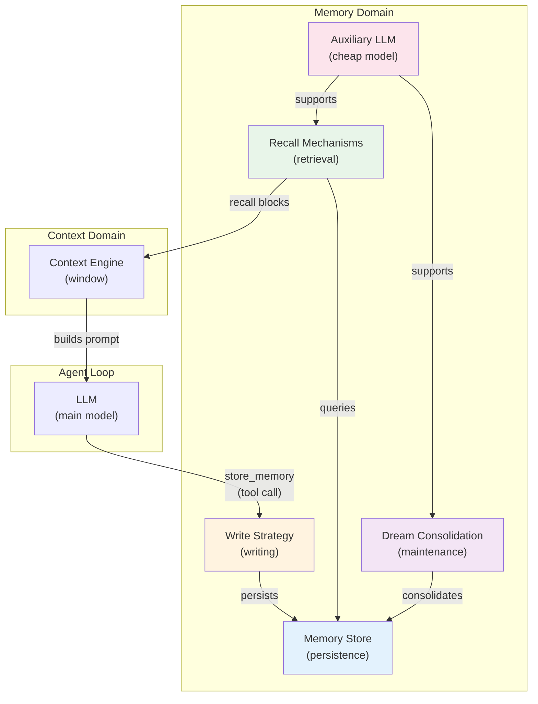
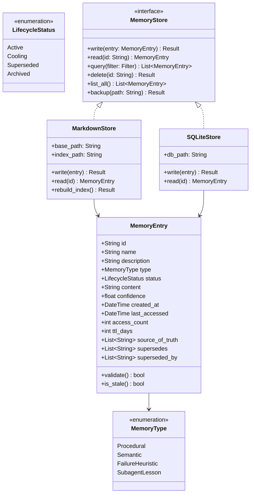
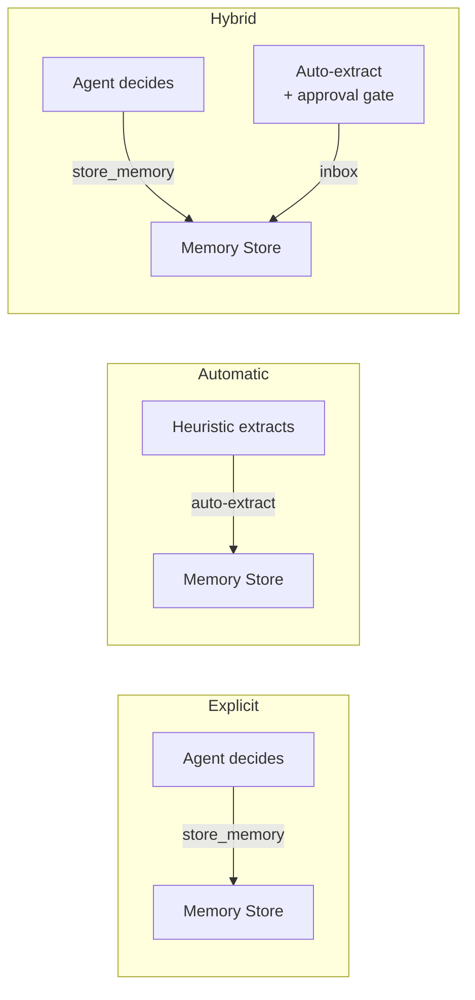
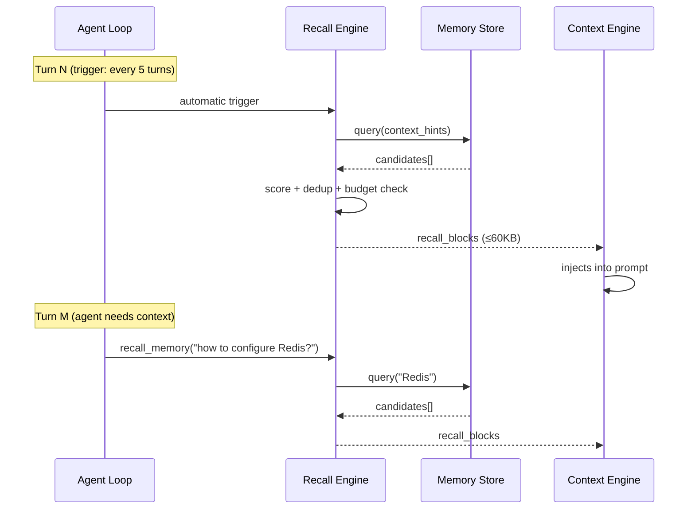
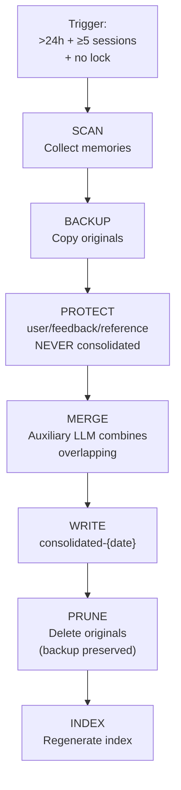
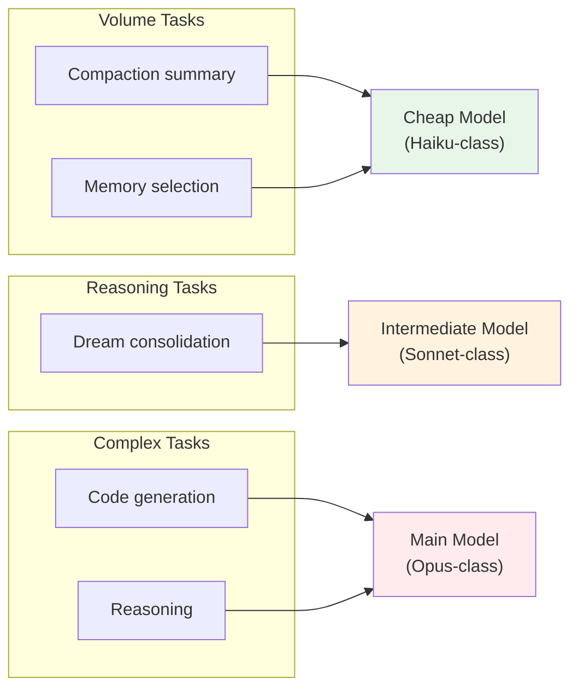
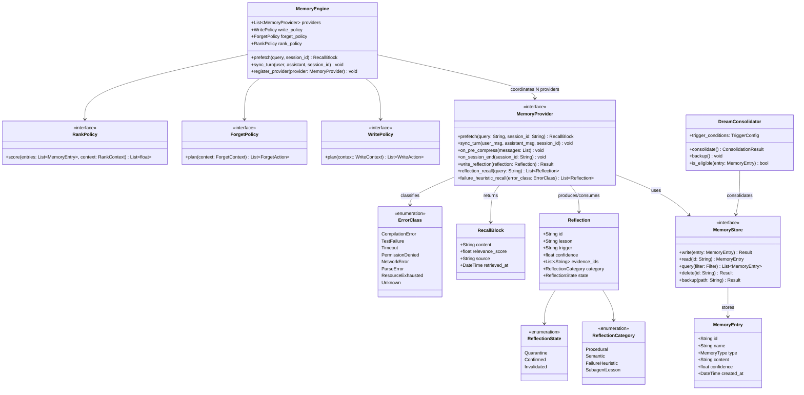
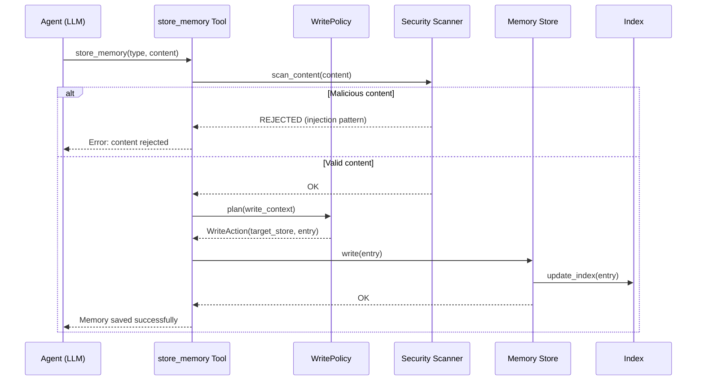
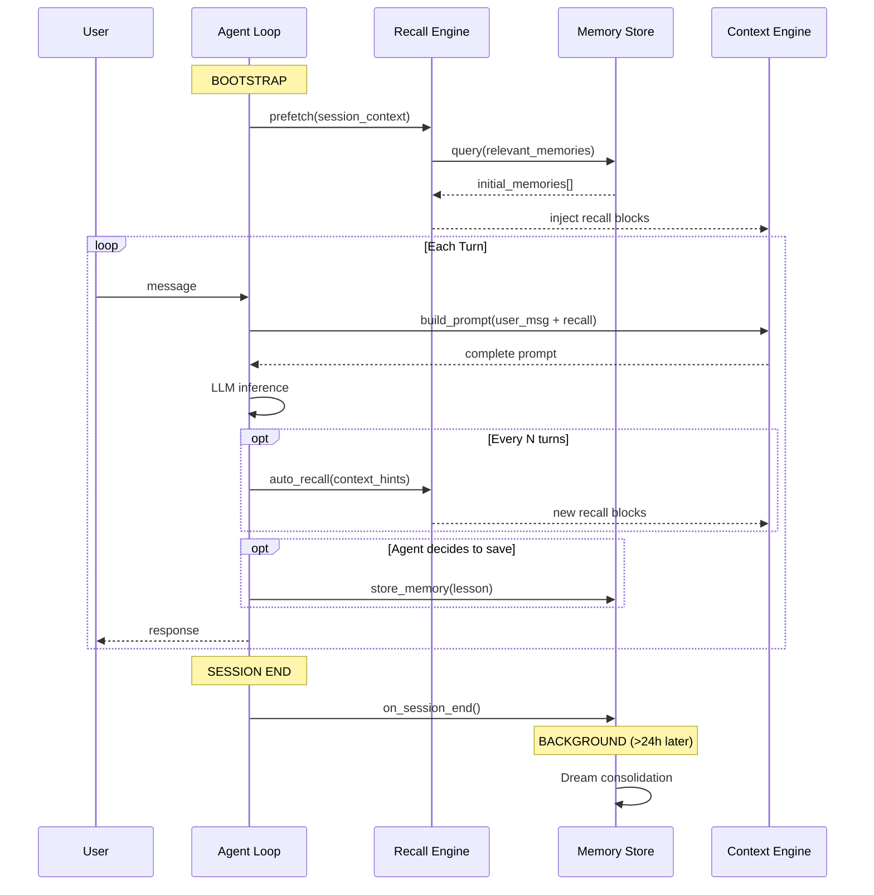

# Memory Systems Architecture

> **Based on:** cross-validation of 12 production implementations + CoALA taxonomy (arXiv:2309.02427) + Anthropic Dreaming (May 2026)

---

## 1. Overview: 5 Components

A SOTA memory system is composed of 5 components that collaborate in a continuous cycle:

```
┌─────────────────────────────────────────────────────────────┐
│                       AGENT LOOP                             │
│                                                              │
│   ┌──────────────┐    recall blocks    ┌────────────────┐   │
│   │              │ ──────────────────► │                │   │
│   │   MEMORY     │                     │    CONTEXT     │   │
│   │  (durable)   │                     │  (ephemeral)   │   │
│   │              │ ◄────── NEVER ───── │                │   │
│   └──────┬───────┘                     └────────────────┘   │
│          │                                     │            │
│          │                                     ▼            │
│   ┌──────┴───────┐                       LLM Prompt        │
│   │ 5 components │                             │            │
│   │              │                             │            │
│   │ 1. Store     │     store_memory            │            │
│   │ 2. Write     │◄───(explicit via tool)──────┘            │
│   │ 3. Recall    │                                          │
│   │ 4. Dream     │         agent decides                    │
│   │ 5. Aux LLM   │         to store                         │
│   └──────────────┘                                          │
└─────────────────────────────────────────────────────────────┘
```

### Component Diagram



---

## 2. Component 1: Memory Store (Persistence)

The physical storage of memories. The choice of format impacts readability, versioning, and queryability.

### Storage Formats

| Format | Characteristics | Trade-offs |
|---|---|---|
| **Markdown with frontmatter** | Human-readable, versionable with git, categorized by YAML metadata | No complex queries, parsing required |
| **Flat markdown** | Simple, human-editable, size limits per file | No structured categorization |
| **SQLite** | SQL queries, ACID, indices | Not human-readable, binary in git |
| **JSONL append-only** | Fast append, streaming, immutable | Not editable, continuous growth |
| **Knowledge Graph** | Explicit relationships, semantic traversal | High complexity, additional infrastructure |

**Industry convergence:** Markdown files with YAML frontmatter are the dominant format in production implementations. Advantages: human-readable, versionable with git, no runtime dependency.

### Structure of a Memory Entry

```yaml
---
name: redis-pipeline-timeout
description: Redis timeout with large pipelines — chunking in batches of 500 resolves
type: failure_heuristic
status: active
confidence: 0.85
created_at: 2026-05-01T14:30:00Z
last_accessed: 2026-05-10T09:00:00Z
access_count: 3
ttl_days: 90
source_of_truth:
  - command: redis-cli INFO
  - file: src/cache/pipeline.rs
supersedes: []
superseded_by: []
---

Redis pipeline with >1000 keys causes timeout.
Solution: chunking in batches of 500.

**Evidence:** Observed 3x in cache module debugging sessions.
```

**Critical fields:**

| Field | Function | Why it matters |
|---|---|---|
| `description` | **Retrieval key** — semantic hook for index match | Generic description kills recall; specific activates at the right moments |
| `status` | Explicit state in the lifecycle | Distinguishes active/stale/superseded/archived |
| `source_of_truth` | Where to validate whether the memory is still true | The agent verifies before acting based on memory |
| `ttl_days` | Time-to-live differentiated by type | Failure heuristics last longer than project status |
| `supersedes` / `superseded_by` | Supersession chain | Traceability when memory is rewritten |

### Class Diagram: Memory Store



---

## 3. Component 2: Write Strategy

Defines **who** decides what to persist and **when**.

→ Details in [03_estrategias_escrita.md](03_estrategias_escrita.md)

### Summary of Approaches



---

## 4. Component 3: Recall Mechanisms

Defines **how** and **when** memories are brought into the context window.

→ Details in [04_mecanismos_recall.md](04_mecanismos_recall.md)

### Recall Flow



---

## 5. Component 4: Dream Consolidation (Maintenance)

Automatic process that keeps the memory store clean and useful over time.

→ Details in [05_consolidacao_dream.md](05_consolidacao_dream.md)

### Simplified Pipeline



---

## 6. Component 5: Auxiliary LLM (Cheap Model)

Volume tasks (compaction, selection, consolidation) don't justify the cost of the main model.

→ Details in [06_llm_auxiliar.md](06_llm_auxiliar.md)

### Task → Model Mapping



---

## 7. Complete Class Diagram



---

## 8. Main Flows

### 8.1 Write Flow



### 8.2 Complete Session Flow



---

## 9. Memory CLI

The memory system exposes a CLI interface for operation and human maintenance. The design follows YAGNI: 3 initial subcommands covering the critical flows, with an explicit roadmap for the rest.

### 9.1 Initial Subcommands (v1)

| Command | What it does | Example |
|---|---|---|
| `memory store` | Creates new entry with validated frontmatter | `memory store --type failure_heuristic --name "redis-timeout"` |
| `memory recall` | Searches memories by query (substring + Jaccard + RRF) | `memory recall "redis pipeline timeout"` |
| `memory lint` | Validates store integrity (10 checks, see Ch 05 §4.1) | `memory lint --fix` |

### 9.2 Roadmap (added on demand, when there is proven need)

| Command | What it does | Criterion to add |
|---|---|---|
| `memory list` | Lists all entries with status and TTL | When store > 20 entries |
| `memory read <id>` | Reads complete entry | When lint detects frequent inconsistencies |
| `memory update <id>` | Updates existing entry (preserves `originSessionId`) | When manual supersession is frequent |
| `memory archive <id>` | Moves entry to Archived | When manual garbage collection is necessary |
| `memory gc` | Garbage collection: prune Archived + superseded entries | When store > 50 entries |
| `memory audit` | Staleness report: entries by status, remaining TTL, last verification | When multiple projects use memory |
| `memory promote <id>` | Moves memory to CLAUDE.md / public knowledge-base | When promotion pattern is recurring |
| `memory compact` | Forces Dream consolidation outside the automatic trigger | When store > 100 entries |
| `memory stale` | Lists entries with expired TTL or no recent access | When manual audit is frequent |

**YAGNI rule:** each roadmap subcommand is only implemented when there are ≥3 occurrences of real, non-speculative need.

---

## 10. Architectural Decisions (ADRs)

The memory system is governed by 6 ADRs that define the design boundaries:

| ADR | Decision | Chapter |
|---|---|---|
| **ADR-01** | No embeddings for recall | [04_mecanismos_recall.md](04_mecanismos_recall.md) |
| **ADR-02** | Explicit writes (agent-driven) | [03_estrategias_escrita.md](03_estrategias_escrita.md) |
| **ADR-09** | Pre-compression hook (notify, not extract) | [03_estrategias_escrita.md](03_estrategias_escrita.md) |
| **ADR-11** | Tiered auxiliary LLM | [06_llm_auxiliar.md](06_llm_auxiliar.md) |
| **ADR-14** | Dream consolidation with atomic types protection | [05_consolidacao_dream.md](05_consolidacao_dream.md) |
| **ADR-15** | Recall frequency: 4 complementary mechanisms | [04_mecanismos_recall.md](04_mecanismos_recall.md) |

→ Next: [03_estrategias_escrita.md](03_estrategias_escrita.md) — Write Strategies
