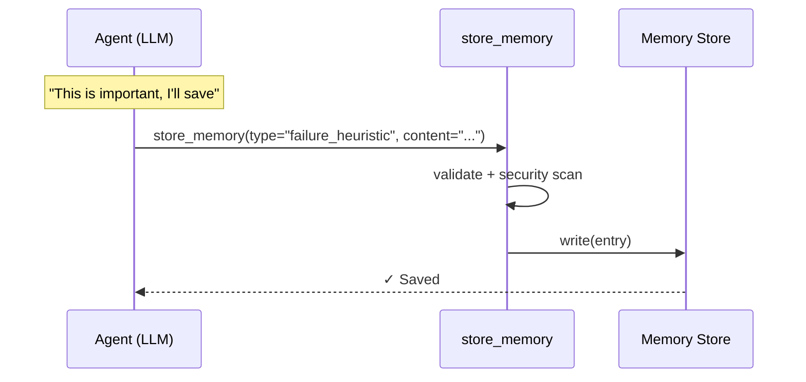
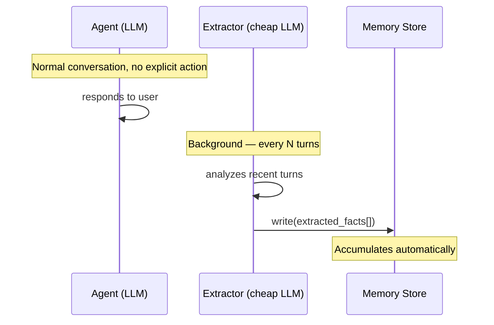
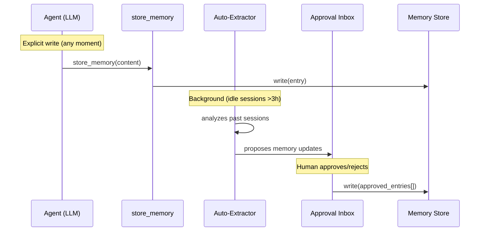
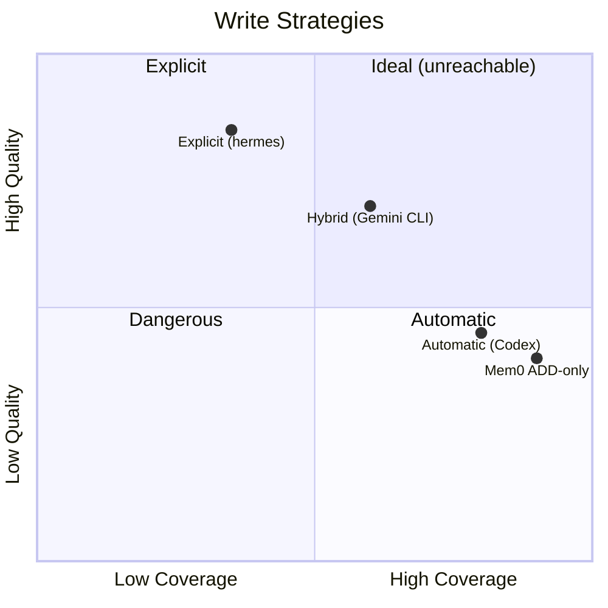
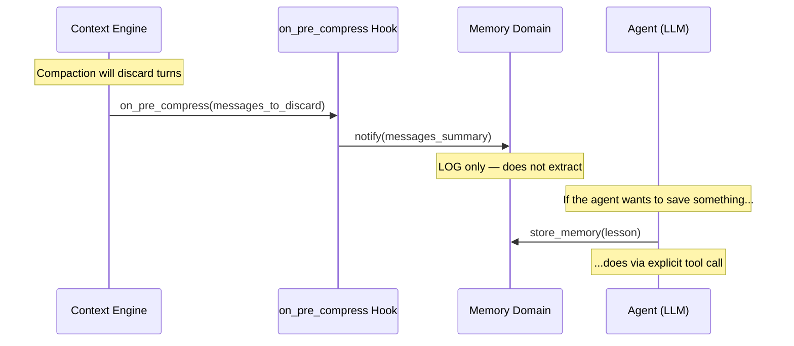
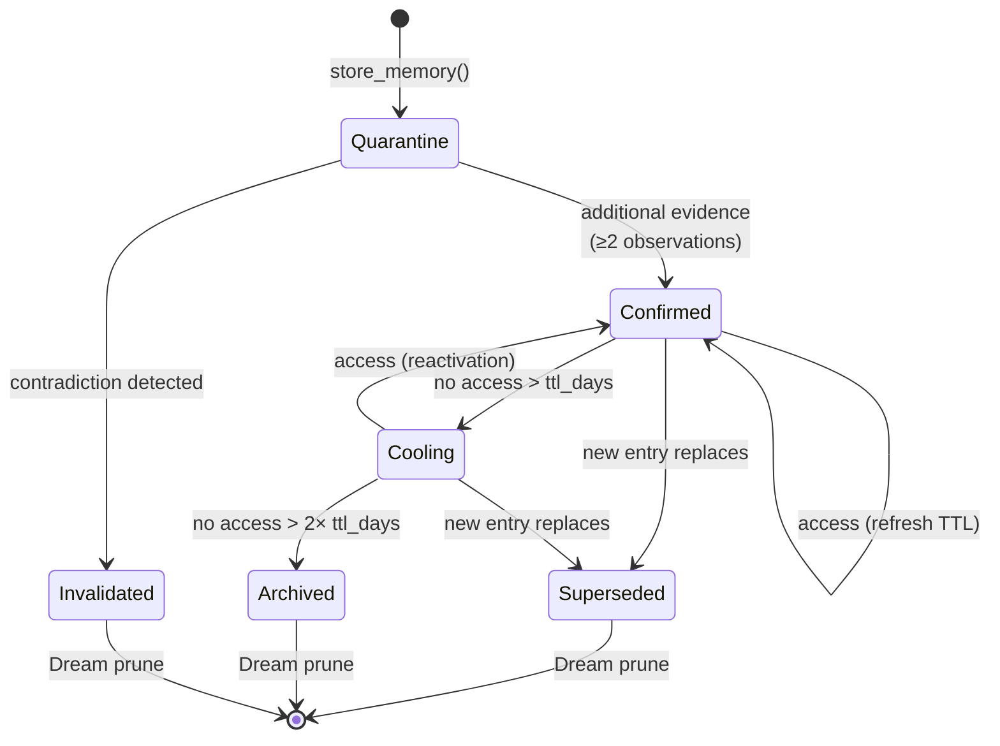

# Write Strategies

> **Related ADRs:** ADR-02 (Explicit Writes), ADR-09 (Pre-Compaction Hook)
> **Evidence:** hermes-agent, opendev, Gemini CLI, Codex (OpenAI), Mem0 (arXiv:2504.19413), The Memory Curse (arXiv:2605.08060)

---

## 1. The Problem

When the agent processes information, not everything deserves to persist. The challenge is: **who decides what to save?**

- If the agent decides, it might forget to save something important.
- If a heuristic extracts automatically, the memory store fills with noise.
- If no one saves, every session starts from scratch.

The write decision is the **most controversial architectural decision** in memory systems.

---

## 2. Three Approaches

### 2.1 Explicit Write (Agent-Driven)

The agent consciously decides what to persist via a tool call.

| Advantage | Disadvantage |
|---|---|
| High quality — agent filters noise | May forget to save |
| Low volume — clean store | Depends on the model's "awareness" |
| No surprises — everything is intentional | Requires prompt engineering to encourage |

### 2.2 Automatic Write (Heuristic-Driven)

A pipeline automatically extracts facts from messages.

| Advantage | Disadvantage |
|---|---|
| High coverage — nothing is lost | Noise risk — fills with irrelevance |
| Doesn't depend on the agent "remembering" | LLM cost for extraction |
| Works with any model | "Memory Curse" — more ≠ better |

### 2.3 Hybrid Write

Combines explicit write with controlled auto-extraction.

| Advantage | Disadvantage |
|---|---|
| Middle-ground — coverage + quality | Additional complexity |
| Human-in-the-loop mitigates noise | Latency (depends on approval) |
| Safety net against forgetting | Inbox may be ignored |

---

## 3. Comparative

| Dimension | Explicit | Automatic | Hybrid |
|---|---|---|---|
| **Store quality** | High | Low-Medium | Medium-High |
| **Coverage** | Medium | High | High |
| **Cost** | Zero (no extra LLM) | High (LLM per turn) | Medium |
| **Complexity** | Simple | Medium | High |
| **Noise risk** | Low | High | Medium |
| **Loss risk** | Medium | Low | Low |

---

## 4. SOTA Recommendation: Explicit Write + Safety Net

### Why explicit?

1. **"The Memory Curse"** (arXiv:2605.08060) proves that more memory can degrade performance. Auto-extraction maximizes volume, which is exactly the opposite of what's desired.

2. **The agent is a better judge of relevance** than extraction heuristics. It has complete context of the task, the objective, and what is actually useful for future sessions.

3. **Zero cost** — does not require an additional LLM for extraction.

### What is the Safety Net?

An `on_pre_compress` hook that **notifies** the memory domain before compaction, but **does not extract automatically**.

**Rule:** the hook **notifies**, but **never extracts**. The decision to save remains with the agent.

---

## 5. ADR-02: Explicit Write (Agent-Driven)

**Status:** Accepted

**Decision:** The agent decides what to persist via the `store_memory` tool. Sub-agent folds are persisted automatically (they are work product, not heuristic).

**Evidence:**
- Explicit writes validated in production by multiple implementations.
- Higher quality, lower noise.
- The agent is a better judge of relevance than extraction heuristics.

**Allowed exception:** sub-agent folds (sub-agent summaries) are work product of the agent, not heuristic extraction. Persisting automatically is acceptable.

---

## 6. ADR-09: Pre-Compaction Hook

**Status:** Accepted

**Decision:** The `on_pre_compress` hook notifies the memory domain, but **does not extract automatically**. Consistent with ADR-02.

**What the hook does:**
- Notifies that turns will be discarded
- Allows logging and metrics
- Allows the agent to be notified (via prompt injection) to save if necessary

**What the hook does NOT do:**
- Does not extract facts automatically
- Does not persist anything to the memory store
- Does not call any LLM for memory summarization

---

## 7. Write Patterns

### 7.1 When to Save

| Moment | What to save | Example |
|---|---|---|
| **Discovery** | New fact about the project | "Module X uses pattern Y" |
| **Resolved error** | Failure heuristic | "Redis timeout with >1000 keys" |
| **Sub-agent returns** | Sub-agent lesson | "Trait Foo is not object-safe" |
| **Decision made** | Architectural decision | "We chose SQLite because Z" |
| **End of session** | Progress summary | "Completed tasks 1-3, 4-5 remain" |

### 7.2 What NOT to Save

| Anti-pattern | Why it's bad |
|---|---|
| Verbatim message content | Redundant, pollutes the store |
| Generic facts about technology | The LLM already knows |
| Temporary debug information | No cross-session value |
| Everything that "might be useful" | Memory Curse — volume degrades |

### 7.3 Memory Entry Lifecycle

**Superseded** vs **Archived**: Superseded means that a more current entry **replaced** this one (`superseded_by` field filled). Archived means that the entry is no longer accessed but was not replaced. Both are prune candidates in Dream, but Superseded has priority.

---

## 8. References

| Source | Insight |
|---|---|
| arXiv:2605.08060 (The Memory Curse) | More memory can degrade — auto-extraction is risky |
| arXiv:2504.19413 (Mem0) | ADD-only extraction: 91.6 LoCoMo, but storage growth |
| Gemini CLI (May 2026) | Inbox approval: middle-ground between explicit and automatic |
| Anthropic Harness Research (2025) | Agent writes progress.txt — minimum viable explicit write |

→ Next: [04_mecanismos_recall.md](04_mecanismos_recall.md) — Recall Mechanisms
