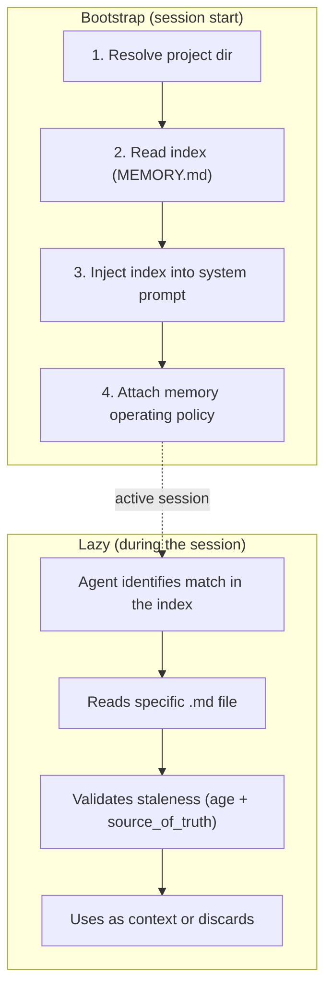
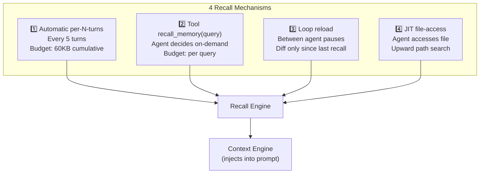
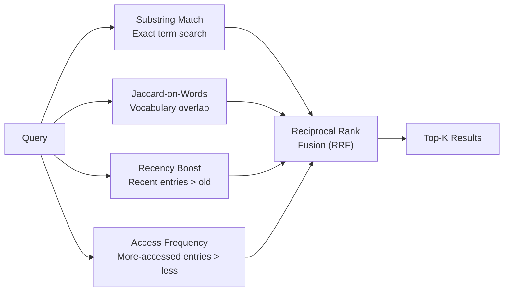
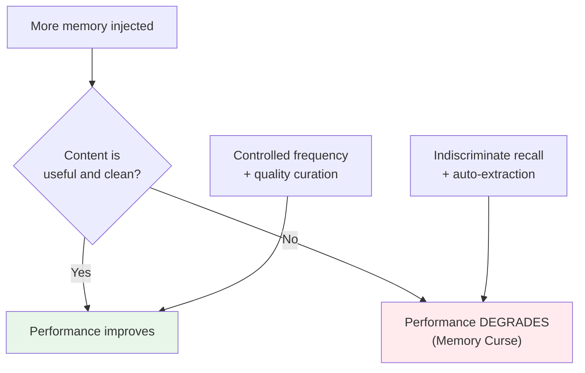
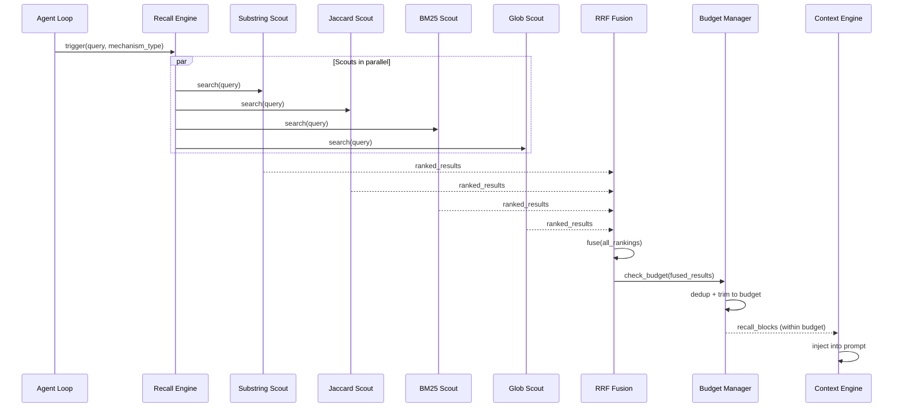
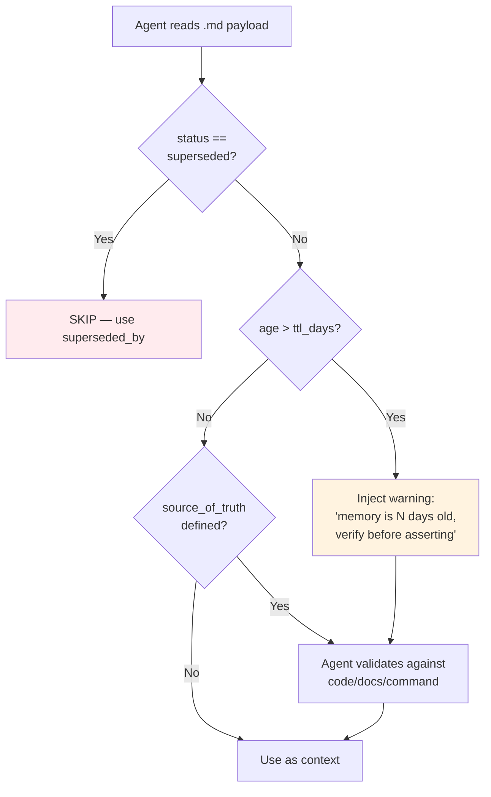

# Recall Mechanisms

> **Related ADRs:** ADR-01 (No Embeddings), ADR-15 (Recall Frequency: 4 Mechanisms)
> **Evidence:** 12 production implementations, The Memory Curse (arXiv:2605.08060), MemMachine (arXiv:2604.04853)

---

## 1. The Problem

The agent has a memory store with dozens to hundreds of entries. Not all are relevant to the current turn. How to decide **which** memories to bring to the context window, **when**, and **in what quantity**?

Two extremes are bad:
- **Recall every turn**: pollutes the context window, wastes tokens.
- **Single-shot recall** (only at bootstrap): insufficient for long sessions with topic change.

---

## 2. ADR-01: No Embeddings

**Status:** Accepted

**Decision:** Do not use embeddings for agent memory recall. The recall pipeline uses substring matching + Jaccard-on-words relevance score + dedup.

### Why no embeddings?

| Argument | Detail |
|---|---|
| **Small volume** | Agent memory store has dozens to hundreds of entries — not thousands. Substring matching is sufficient. |
| **No external dependency** | Embeddings require an additional model (cost, latency, infrastructure). |
| **No production implementation uses them** | Of the 12 implementations analyzed, zero use embeddings for agent memory. |
| **Unjustified complexity** | Vector index (FAISS, ChromaDB, etc.) adds infrastructure for a problem that substring solves. |

### What is allowed

- **Substring matching** — keyword search in content.
- **Jaccard-on-words** — relevance score based on word overlap between query and entry.
- **Dedup by normalization** — avoids duplicates by comparison of normalized content.
- **Auxiliary LLM for selection** — cheap model selects relevant files by name + description (classification, not embedding).

### When to reevaluate

If the volume of reflections exceeds **1000 entries** AND there is **empirical evidence** of recall quality degradation, open discussion to reevaluate. Never adopt embeddings silently.

**Note:** QMD uses hybrid (BM25 + vector + rerank), but for **project documents**, not for agent memory. The distinction is important — documents scale to thousands; agent memories don't.

---

## 3. The Bootstrap + Lazy Pattern

Before the 4 mechanisms, it's essential to understand the loading model:



**The index is the router, not the memory** (Invariant I11). It is fully loaded and has fixed, predictable cost. Payloads are read on demand and have cost proportional to usage.

The system injects **two components** at bootstrap:
1. **Memory data** — the index with titles, types, and descriptions.
2. **Memory operating policy** — the rules of when to save, query, update, and not duplicate.

Without the rules, the model would know that memories exist, but would not know when to act on them.

---

## 4. ADR-15: Recall Frequency — 4 Complementary Mechanisms

**Status:** Accepted — **Reinforced by empirical evidence** (The Memory Curse, arXiv:2605.08060)

**Decision:** Four complementary mechanisms, each covering a different scenario:



### 4.1 Mechanism 1: Automatic per-N-turns

| Parameter | Value |
|---|---|
| **Trigger** | Every N turns (default: 5) |
| **Budget** | Cumulative 60KB per session |
| **Dedup** | Hash of `manifest + query` avoids unnecessary re-query |
| **Behavior** | If the manifest hash hasn't changed since the last recall, skip |

```mermaid
sequenceDiagram
    participant Loop as Agent Loop
    participant Counter as Turn Counter
    participant Recall as Recall Engine
    participant Store as Memory Store
    participant Cache as Hash Cache
    
    Loop->>Counter: turn++
    alt turn % N == 0
        Counter->>Recall: trigger_recall()
        Recall->>Cache: check hash(manifest + context)
        alt Hash changed
            Recall->>Store: query(context_hints)
            Store-->>Recall: candidates[]
            Recall->>Recall: score + rank + budget
            Recall-->>Loop: recall_blocks
        else Hash equal
            Cache-->>Recall: SKIP (nothing new)
        end
    end
```

### 4.2 Mechanism 2: Tool `recall_memory(query)`

The agent decides that it needs additional context and makes an explicit recall.

| Parameter | Value |
|---|---|
| **Trigger** | Agent tool call |
| **Budget** | Per query (configurable) |
| **Behavior** | Semantic search by query in the store |

**Example of use:** the agent is debugging a Redis error and decides: "I've seen something similar before" → `recall_memory("redis timeout pipeline")`.

### 4.3 Mechanism 3: Loop Reload

Between agent pauses (user input, transition between sub-tasks), reloads only the **diff** of reflections written mid-session.

| Parameter | Value |
|---|---|
| **Trigger** | Agent pause |
| **Budget** | Only new entries since last recall |
| **Behavior** | Does not re-inject everything — only the delta |

**Scenario:** the agent wrote 3 memories during the session. When the user sends a new message, the reload injects only these 3 new memories.

### 4.4 Mechanism 4: JIT File-Access

When the agent accesses a file, it automatically searches for memories associated with that path.

| Parameter | Value |
|---|---|
| **Trigger** | File access (read/write) |
| **Budget** | Per file |
| **Behavior** | Upward path search: searches for memories associated with the file, parent directory, etc. |

**Scenario:** the agent opens `src/billing/calculator.rs`. JIT searches for memories associated with "billing", "calculator", "src/billing/" — and finds: "billing module has known race condition in parallel calculation".

---

## 5. Relevance Scoring

### 5.1 Without Embeddings: Scoring Strategies



### 5.2 Reciprocal Rank Fusion (RRF)

Combines rankings from multiple signals without arbitrary weights:

```
RRF_score(entry) = Σ 1 / (k + rank_i(entry))
```

Where `k` is a constant (default: 60) and `rank_i` is the entry's ranking in signal `i`.

### 5.3 Budget Management

Recall has a **cumulative budget** to avoid polluting the window:

| Parameter | Default | Justification |
|---|---|---|
| **Budget per session** | 60KB | ~15K tokens — enough for ~30 entries |
| **Max entries per recall** | 10 | Avoids injection of a huge block |
| **Dedup window** | Last 20 recalls | Avoids re-injecting the same memory |

---

## 6. The Danger of Over-Recall

### The Memory Curse (arXiv:2605.08060)

Empirical evidence that **more recall can be worse**:

- Tested in 18/28 model-game combinations.
- Expanding accessible history **degrades cooperation**.
- The trigger is the **content** of memory, not the size.
- **Memory sanitization** (replacing with cooperative records) restores performance.

### Design Implications



**Conclusion:** the combination of **explicit writes** (ADR-02) + **controlled recall** (ADR-15) is the defense against the Memory Curse. Controlled volume + curated content.

---

## 7. Sequence Diagram: Complete Recall



---

## 8. Staleness Verification on Recall

When the agent reads a memory file on demand, the system must verify staleness before use:



**Rule:** memory suggests where to look. Code decides what is true. The agent NEVER asserts as fact something that came only from stale memory without verification.

---

## 9. References

| Source | Insight |
|---|---|
| arXiv:2605.08060 (The Memory Curse) | More memory can degrade — controlled recall is essential |
| arXiv:2604.04853 (MemMachine) | SOTA LoCoMo 0.9169 with raw episodes + summaries |
| arXiv:2504.19413 (Mem0) | Multi-signal retrieval (dense + BM25 + entity) |
| arXiv:2501.13956 (Zep/Graphiti) | Temporal KG, 94.8% DMR |
| arXiv:2603.07670 (Memory for LLM Agents) | 5 mechanism families for recall |

→ Next: [05_consolidacao_dream.md](05_consolidacao_dream.md) — Consolidation (Dream)
