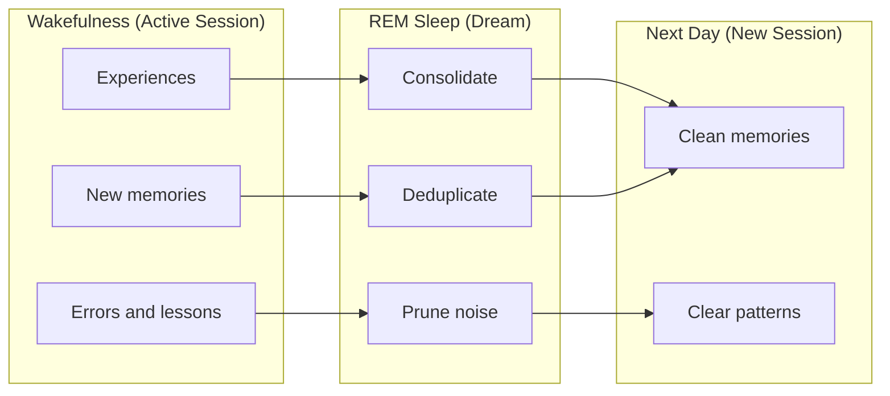
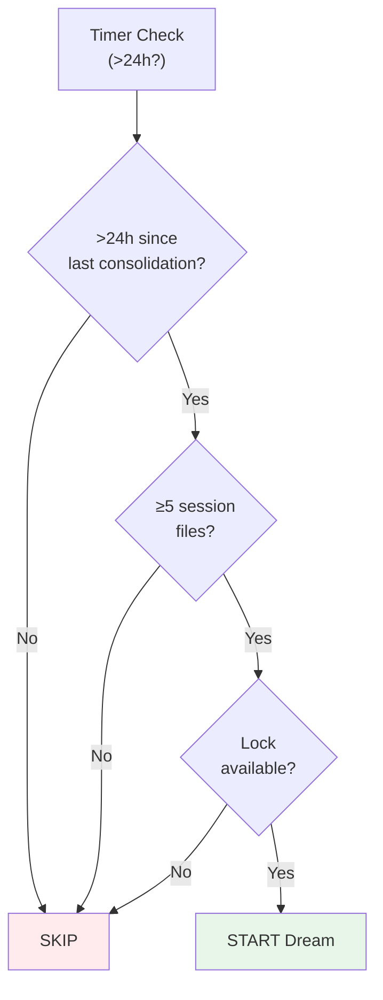
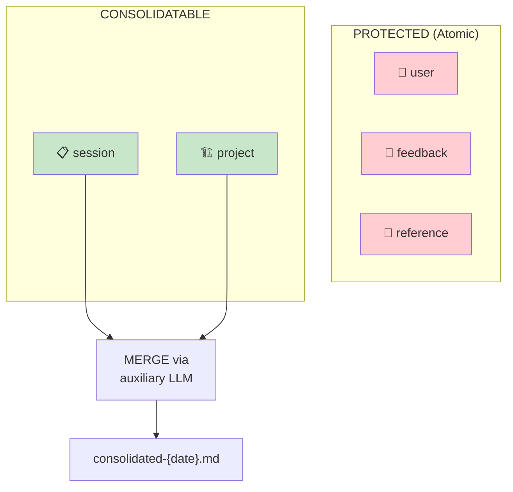
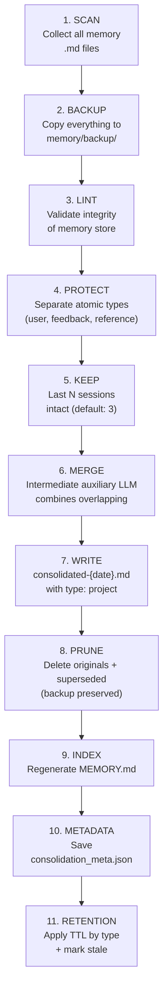
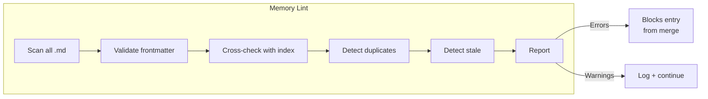
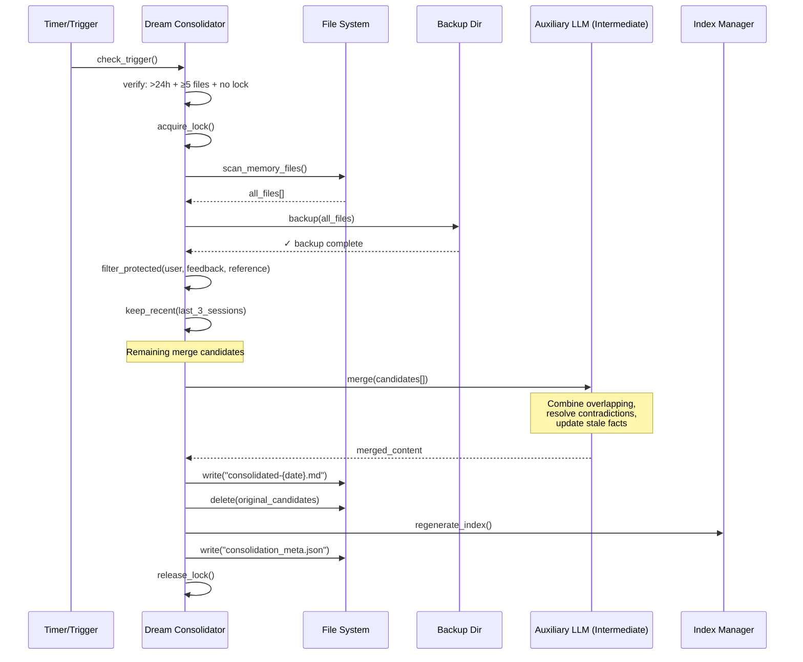
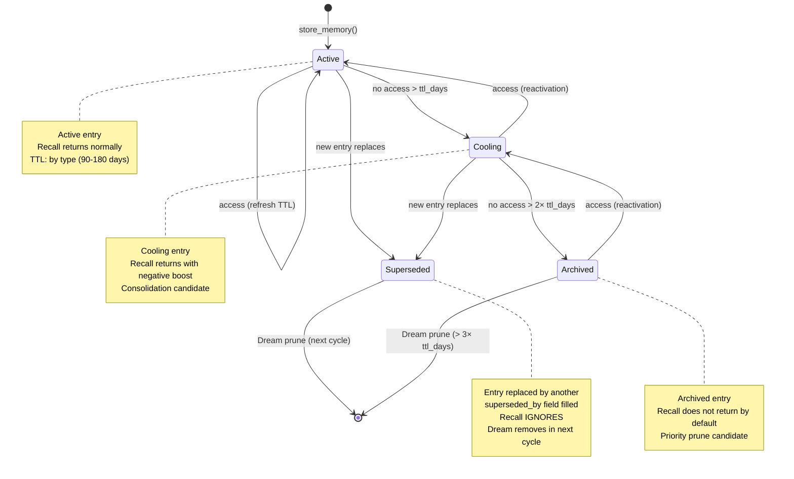

# Consolidation (Dream)

> **Related ADR:** ADR-14 (Dream Consolidation with Atomic Types Protection)
> **Validation:** Anthropic Dreaming (production, May 2026) — identical pattern, Harvey reports 6x task completion improvement

---

## 1. The Problem

Over time, the memory store accumulates:
- **Duplicates** — the same lesson saved in different sessions.
- **Contradictions** — one entry says X, another says ¬X.
- **Stale information** — facts that are no longer true.
- **Fragmentation** — the same knowledge scattered across multiple entries.

Without maintenance, the memory store degrades: recall returns noise, the agent gets confused, and the Memory Curse (arXiv:2605.08060) materializes.

**Dream** is the automatic consolidation process that keeps the store clean and useful.

---

## 2. Cognitive Analogy

The name "Dream" comes from neuroscience: during REM sleep, the brain consolidates memories — strengthens relevant ones, discards noise, and forms connections between experiences.



---

## 3. ADR-14: Dream Consolidation

**Status:** Accepted — **VALIDATED IN PRODUCTION** (Anthropic Dreaming, May 2026)

### 3.1 Trigger Conditions

Dream fires automatically when **all** conditions are satisfied:

| Condition | Default Value | Justification |
|---|---|---|
| Time since last consolidation | >24 hours | Avoids consolidation during active session |
| Minimum number of session files | ≥5 | Need enough material to consolidate |
| Concurrent lock | Absent | Avoids corruption from simultaneous access |



### 3.2 Protected vs Consolidatable Types

**Fundamental rule:** atomic types are **NEVER** consolidated.

| Type | Consolidatable? | Reason |
|---|---|---|
| `user` | **NEVER** | Personal information — loss is irreversible |
| `feedback` | **NEVER** | User corrections — each one is unique |
| `reference` | **NEVER** | Pointers to resources — there is nothing to "merge" |
| `session` | **YES** | Session summaries can be combined |
| `project` | **YES** | Project facts can be updated |



---

## 4. 11-Step Pipeline



### Details of Each Step

| Step | What it does | Can fail? | Fallback |
|---|---|---|---|
| **1. SCAN** | Lists all .md files in the memory directory | Yes (permission) | Abort with log |
| **2. BACKUP** | Copies all files to `memory/backup/{timestamp}/` | Yes (full disk) | Abort — **NEVER** proceed without backup |
| **3. LINT** | Validates store integrity (see §4.1 Memory Lint) | Yes (invalid entries) | Log warnings, continue with valid entries |
| **4. PROTECT** | Filters atomic types — they do not participate in the merge | No | — |
| **5. KEEP** | Excludes the last N session files from the merge (recency) | No | — |
| **6. MERGE** | Intermediate auxiliary LLM analyzes candidates and combines overlapping | Yes (LLM error) | Abort — backup intact |
| **7. WRITE** | Creates `consolidated-{date}.md` with the merge result | Yes (I/O) | Abort |
| **8. PRUNE** | Deletes consolidated originals + superseded entries (backup exists) | Yes (I/O) | Log warning, retry |
| **9. INDEX** | Regenerates the index file (MEMORY.md) | Yes (I/O) | Retry |
| **10. METADATA** | Saves `consolidation_meta.json` with timestamp, file count, lint results | Yes (I/O) | Log warning |
| **11. RETENTION** | Applies TTL by type (§7.1), marks stale entries, transitions lifecycle | No | — |

### 4.1 Memory Lint (Step 3)

Lint validates the integrity of the memory store before any destructive modification. It can also be run standalone via CLI (`memory lint`).

**Checks:**

| # | Check | Severity | Action |
|---|---|---|---|
| L1 | Index line > 150 chars | Warning | Log + suggest shortening |
| L2 | File referenced in the index does not exist on disk | Error | Remove from index |
| L3 | File exists on disk but is not in the index | Warning | Suggest adding or archiving |
| L4 | Frontmatter absent or malformed | Error | Reject entry from merge |
| L5 | Type (`type`) not recognized | Error | Reject entry |
| L6 | Generic `description` (< 20 chars or no specific terms) | Warning | Log + suggest rewriting |
| L7 | Empty `name` | Error | Reject entry |
| L8 | Entry with `status: superseded` without `superseded_by` filled | Warning | Log |
| L9 | Entry with `ttl_days` expired and `status: active` | Warning | Transition to Cooling |
| L10 | Semantic duplicates (Jaccard > 0.8 between descriptions) | Warning | Suggest merge |



**Output:** `LintReport` with error/warning count, blocked entries, and action suggestions.

---

## 5. Sequence Diagram



---

## 6. Memory Lifecycle

Entries in the memory store go through a lifecycle with temporal decay based on TTL by type (§7.1):



### Forgetting Curve (Inspiration: MemoryBank, arXiv:2305.10250)

An entry's relevance decays with time, but each access strengthens it:

```
relevance(t) = base_score × e^(-t / S)

where:
  t = time since last access (days)
  S = strength (increases with each access, initial = ttl_days of the type)
  base_score = original score of the entry
```

The `ttl_days` of the type serves as the initial value of `S`, ensuring that entries with longer TTL decay more slowly.

---

## 7. Retention Policy

### 7.1 TTL Differentiated by Type

Not all memories age at the same rate. The default TTL is defined by type:

| Type | Default TTL | Justification |
|---|---|---|
| **Procedural** | 180 days | Procedures change slowly; high reuse value |
| **Semantic** | 180 days | Domain facts are relatively stable |
| **FailureHeuristic** | 90 days | Errors can be fixed; decay if not reconfirmed |
| **SubagentLesson** | 90 days | Sub-agent lessons can become stale with refactors |

**Note:** the `ttl_days` field in the frontmatter allows override per entry. The TTL above is the default when the field is omitted.

### 7.2 Action Table

| Criterion | Action | Frequency |
|---|---|---|
| Entry > `ttl_days` without access | Moves to Cooling | Continuous |
| Entry > 2× `ttl_days` without access in Cooling | Moves to Archived | Continuous |
| Entry Archived > 3× `ttl_days` | Automatic prune (backup preserved) | Each Dream |
| Entry >7 days without use | Priority prune candidate | Each Dream |
| Entry with `status: superseded` | Prune (backup preserved) | Each Dream |
| Contradiction detected | LLM resolves — keeps the most recent, supersedes the old | Each Dream |
| Duplicate detected | Merge — combines and keeps one, supersedes the originals | Each Dream |

---

## 8. Validation in Production

### Anthropic Dreaming (May 2026)

Anthropic launched "Dreaming" as a production feature (API `dreaming-2026-04-21`). The pattern is **identical** to ADR-14:

| Aspect | ADR-14 | Anthropic Dreaming |
|---|---|---|
| **Trigger** | Scheduled (>24h) | Scheduled |
| **Action** | Review + merge + prune | Review + merge + prune |
| **Protection** | Atomic types never consolidated | Protected types |
| **Backup** | Required before modification | Immutable versions |
| **LLM** | Intermediate auxiliary | Background LLM |

**Result:** Harvey reports **6x improvement** in task completion with Dream active.

---

## 9. Consolidation Metadata

Each consolidation saves metadata for auditing:

```json
{
  "timestamp": "2026-05-11T03:00:00Z",
  "files_scanned": 15,
  "files_protected": 4,
  "files_kept_recent": 3,
  "files_consolidated": 8,
  "files_pruned": 8,
  "output_file": "consolidated-2026-05-11.md",
  "backup_path": "memory/backup/2026-05-11T03:00:00Z/",
  "duration_seconds": 12,
  "llm_model_used": "sonnet-class",
  "tokens_used": 4500
}
```

---

## 10. References

| Source | Insight |
|---|---|
| Anthropic Dreaming (production, May 2026) | Production validation of the Dream pattern — 6x task completion |
| arXiv:2305.10250 (MemoryBank) | Ebbinghaus forgetting curve for score decay |
| arXiv:2605.08060 (The Memory Curse) | Uncontrolled volume degrades — consolidation is essential |
| arXiv:2605.06716 (Storage→Experience) | Dream is the bridge between Reflection and Experience stages |

→ Next: [06_llm_auxiliar.md](06_llm_auxiliar.md) — Tiered Auxiliary LLM
