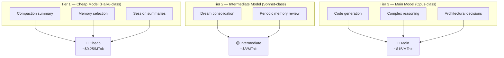
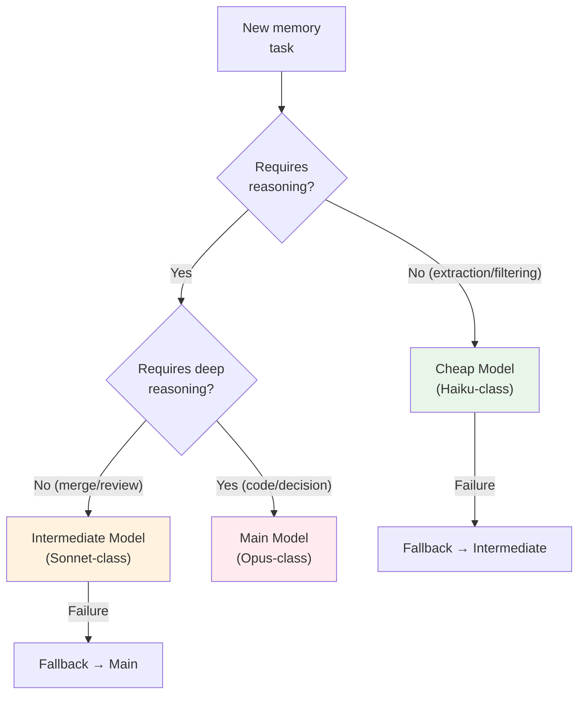
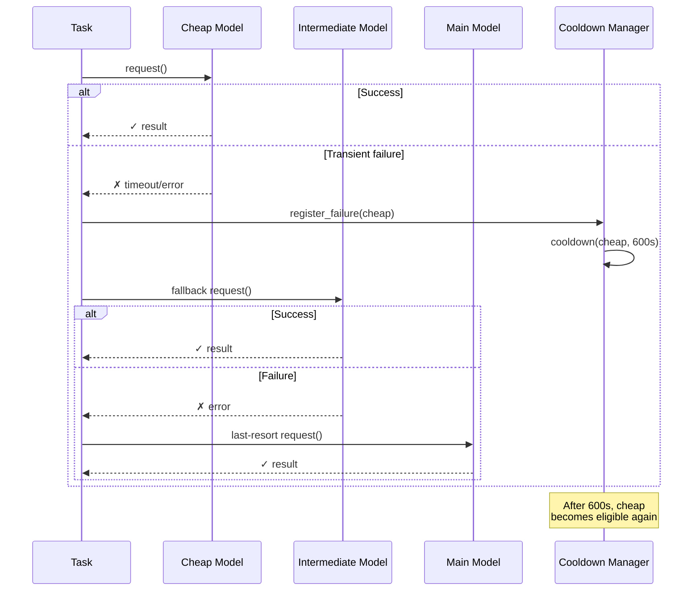

# Tiered Auxiliary LLM

> **Related ADR:** ADR-11 (Auxiliary LLM — Cheap Model for Volume)
> **Evidence:** hermes-agent, opendev, Codex (OpenAI), Gemini CLI

---

## 1. The Problem

The main model (Opus-class) is expensive and slow. Many memory system tasks do not require deep reasoning:

| Task | Complexity | Need Opus? |
|---|---|---|
| Summarize turns for compaction | Low (extraction) | **No** |
| Select relevant memories | Low (filtering) | **No** |
| Consolidate memories (Dream) | Medium (merge + reasoning) | **No** |
| Generate code / solve bug | High (complex reasoning) | **Yes** |

Using the main model for everything wastes money and time. The solution is a **tiered system** that routes tasks to the appropriate model.

---

## 2. ADR-11: Tiered System

**Status:** Accepted

### Task → Model Mapping



| Task | Model | Timeout | Justification |
|---|---|---|---|
| **Compaction summary** | Cheap (Haiku-class) | 30s | High volume, simple reasoning — information extraction |
| **Memory selection** | Cheap (Haiku-class) | 10s | Filtering by name + description, not generation |
| **Session summary** | Cheap (Haiku-class) | 30s | Structured summary, fixed template |
| **Dream consolidation** | Intermediate (Sonnet-class) | Background | Merge requires reasoning — resolving contradictions, combining overlap |
| **Periodic memory review** | Intermediate (Sonnet-class) | Background | Quality assessment, cleanup suggestions |

---

## 3. Decision Diagram



---

## 4. Fallback and Cooldown

### Fallback Strategy

When the auxiliary model fails, the system escalates to the next tier:



### Cooldown Rules

| Parameter | Value | Justification |
|---|---|---|
| **Cooldown after transient failure** | 600 seconds (10 min) | Avoids retry storm against unavailable model |
| **Max retries before fallback** | 1 | Fail-fast — don't waste time |
| **Cooldown reset** | After success | Returns to normal when the model recovers |

---

## 5. Savings

### Cost Example per Session

Assuming a 2-hour session with 50 turns:

| Operation | Quantity | Model | Tokens/op | Unit cost | Total |
|---|---|---|---|---|---|
| Compaction | 3 | Cheap | ~2K | ~$0.0005 | $0.0015 |
| Memory selection | 10 | Cheap | ~500 | ~$0.0001 | $0.001 |
| Dream | 0-1 | Intermediate | ~5K | ~$0.015 | $0.015 |
| **Total memory ops** | — | — | — | — | **~$0.02** |
| **If main model used** | — | — | — | — | **~$0.30** |

**Savings:** ~**15x cheaper** using the tiered system.

---

## 6. Configurability

The task → model mapping must be **configurable**, not hardcoded:

```yaml
# Auxiliary models configuration
auxiliary_llm:
  compaction:
    model: "haiku-class"
    timeout_seconds: 30
    fallback: "sonnet-class"
  memory_selection:
    model: "haiku-class"
    timeout_seconds: 10
    fallback: "sonnet-class"
  dream_consolidation:
    model: "sonnet-class"
    timeout_seconds: 120
    fallback: "opus-class"
  cooldown_seconds: 600
```

**Rule:** never hardcode model names. The mapping must be configurable by the user to adapt to different providers (Anthropic, OpenAI, Google, etc.).

---

## 7. Anti-Patterns

| Anti-pattern | Why it's bad |
|---|---|
| Using main model for compaction | 15x waste in cost |
| Hardcoding the model name | Prevents provider switching |
| No fallback | Auxiliary failure stalls the pipeline |
| No cooldown | Retry storm against unavailable model |
| No timeout | $0.001 task can block for minutes |

---

## 8. References

| Source | Insight |
|---|---|
| Codex (OpenAI) | 2-phase: `gpt-5.4-mini` (extraction) + `gpt-5.4` (consolidation) |
| hermes-agent | 30s timeout for compaction with auxiliary model |
| opendev | Separate `compact_model` for compaction |
| Gemini CLI | Background processing with auxiliary model |

→ Next: [07_seguranca.md](07_seguranca.md) — Security
