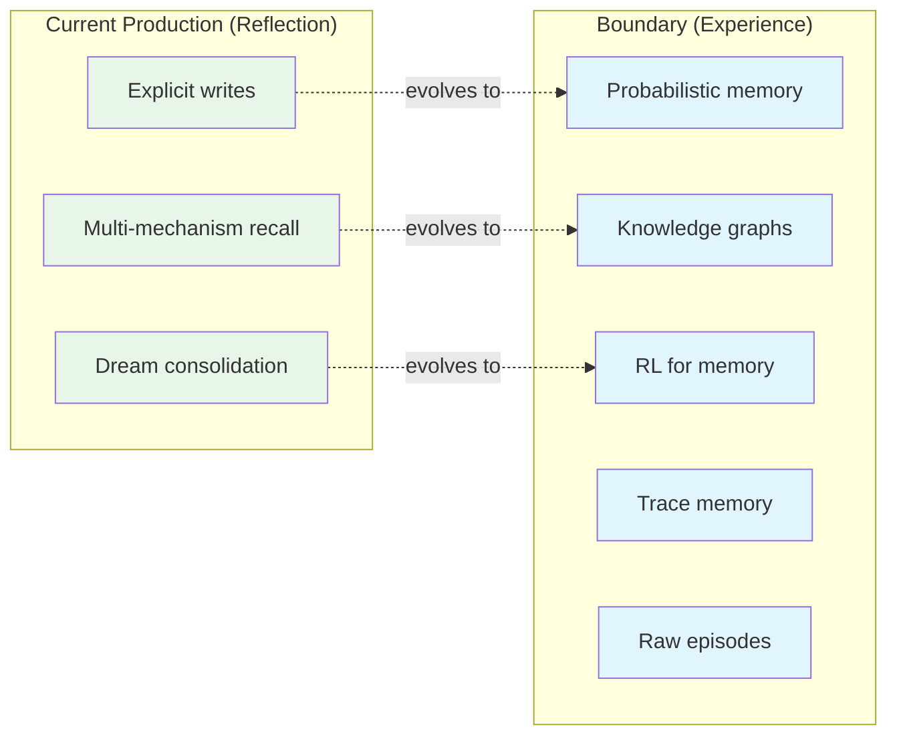
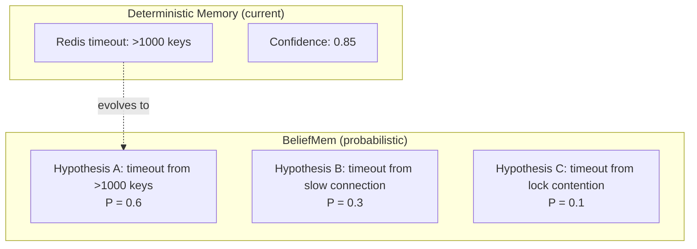
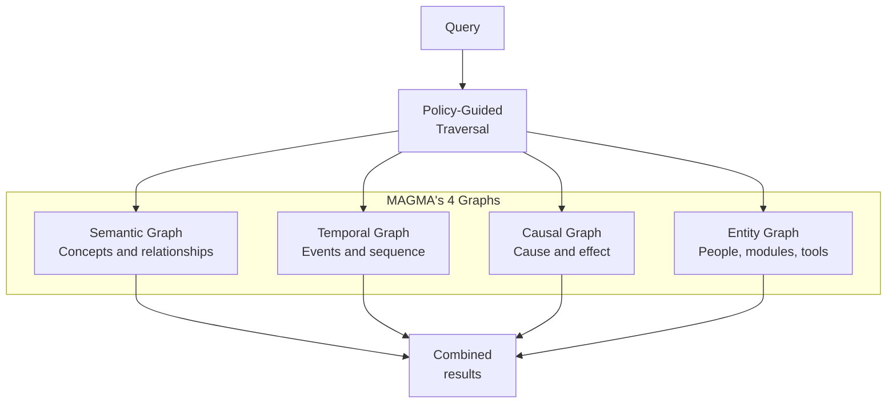
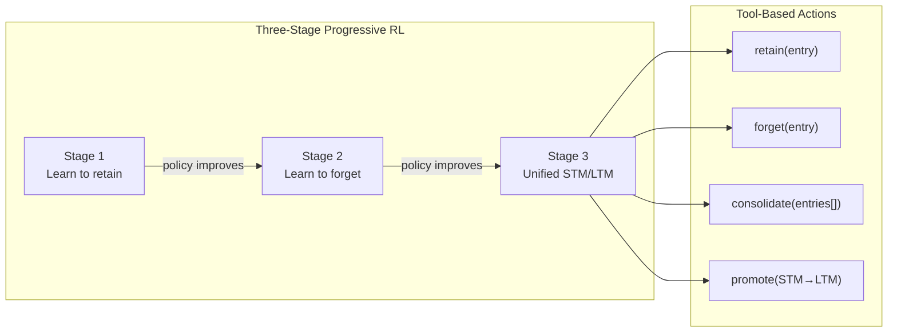
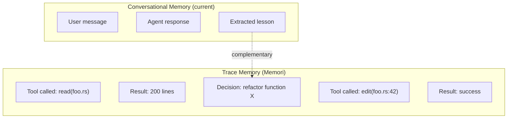
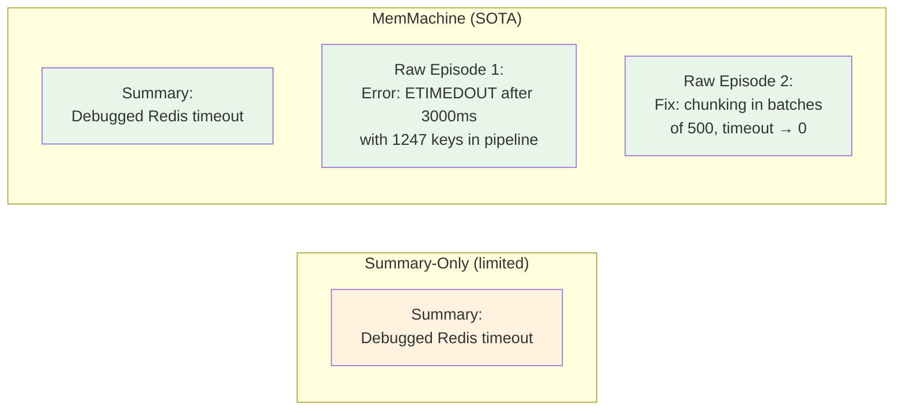
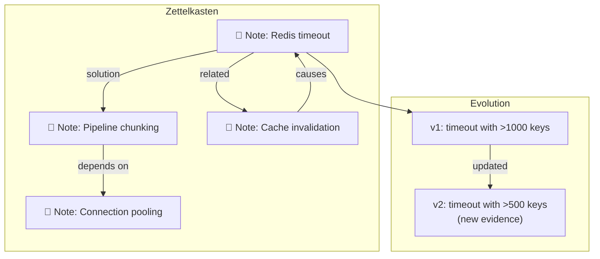

# Emerging Paradigms

> **Status:** None of these paradigms is in production in reference implementations. They are active research directions with potential impact.

---

## 1. Overview

The state of the art in memory systems is in the **Reflection** stage (arXiv:2605.06716). The paradigms below point to the next stage — **Experience** — where memories are abstractions that transcend individual sessions.

---

## 2. Paradigms

### 2.1 BeliefMem — Probabilistic Memory

**Paper:** arXiv:2605.05583, May 2026

**Concept:** instead of deterministic reflections ("X is true"), keep multiple candidate conclusions with probabilities.

**Mechanism:** update via Noisy-OR — new evidence adjusts probabilities of all hypotheses.

**Status:** concept — no production implementation.

**Potential impact:** reduces false positives in failure heuristics, where the real cause may have multiple explanations.

---

### 2.2 MAGMA — Multi-Graph Memory

**Paper:** arXiv:2601.03236

**Concept:** 4 types of graphs operating in parallel, with policy-guided traversal:

**Status:** paper with code.

**Potential impact:** more accurate recall for complex queries involving temporal or causal relationships.

---

### 2.3 AgeMem — RL for Memory Management

**Paper:** arXiv:2601.01885, updated April 2026

**Concept:** use Reinforcement Learning to learn when to retain, when to forget, and when to consolidate.

**Status:** paper with code. Step-wise GRPO for sparse rewards.

**Potential impact:** replace manual heuristics (forgetting curve, retention policy) with learned policy.

---

### 2.4 Memori Labs — Trace Memory

**Paper/Product:** Memori Labs, May 2026 (OpenClaw v0.0.10 Plugin)

**Concept:** memory of the **execution trace** (paths, tool results, decisions), not the conversation.

**Status:** OpenClaw plugin v0.0.10.

**Potential impact:** the agent remembers **how** it did something (sequence of actions), not just **what** it learned. Useful for replay and debugging.

---

### 2.5 MemMachine — Raw Episodes + Summaries

**Paper:** arXiv:2604.04853, April 2026

**Concept:** summaries alone lose factual detail. The combination of summaries + selective raw episodes is superior.

**Result:** SOTA LoCoMo benchmark: 0.9169.

**Potential impact:** factual and temporal queries preserve accuracy that summaries alone lose.

---

### 2.6 A-MEM — Zettelkasten for Agents

**Paper:** arXiv:2502.12110, NeurIPS 2025

**Concept:** atomic notes with dynamic links that evolve over time (inspired by the Zettelkasten method).

**Status:** paper with code (NeurIPS 2025 poster).

**Potential impact:** connected and evolvable memories. **Caveat:** memory mutation creates risk of inconsistency — requires versioning.

---

### 2.7 Feedback-Normalized Dev Memory

**Paper:** arXiv:2605.01567, May 2026

**Concept:** MCP-native memory with recall quality telemetry. Memory selection as a logged decision process with bounded rewards.

**Status:** paper.

**Potential impact:** first paper linking MCP to developer memory. Allows measuring and optimizing recall quality empirically.

---

### 2.8 ERL — Failure Heuristics First

**Paper:** arXiv:2603.24639

**Concept:** failure heuristics are more valuable than success heuristics (+14.3% on search tasks).

**Status:** paper with code. Already absorbed in production implementations as the failure_heuristic recall pattern.

**Impact:** validated — failure heuristics are first priority in recall.

---

## 3. Comparative Summary

| Paradigm | Paper | Maturity | Contradicts ADRs? | Potential |
|---|---|---|---|---|
| **BeliefMem** | arXiv:2605.05583 | Concept | No — complements | Medium |
| **MAGMA** | arXiv:2601.03236 | Paper + code | Potential ADR-01 (graph index) | High |
| **AgeMem** | arXiv:2601.01885 | Paper + code | No — replaces heuristics | High |
| **Memori Labs** | OpenClaw Plugin | Early product | No — complements | Medium |
| **MemMachine** | arXiv:2604.04853 | Paper + code | No — complements | High |
| **A-MEM** | arXiv:2502.12110 | NeurIPS 2025 | No — complements | Medium |
| **Feedback-Norm** | arXiv:2605.01567 | Paper | No — complements | Medium |
| **ERL** | arXiv:2603.24639 | **Absorbed** | No | **Validated** |

---

## 4. Future Directions

### 4.1 Short-term (next 6 months)
- **Raw episodes + summaries** (MemMachine) — proven gain, simple implementation.
- **Recall quality telemetry** (Feedback-Normalized) — measure to improve.
- **Versioned memory writes** — audit trail for rollback (validated by Anthropic Dreaming).

### 4.2 Medium-term (6-12 months)
- **Trace memory** (Memori Labs) — complements conversational memory.
- **A-MEM Zettelkasten** — when reflection volume grows, dynamic links are justified.
- **Bi-temporal validity** — `t_valid` + `t_recorded` for staleness without deleting.

### 4.3 Long-term (>12 months)
- **BeliefMem** — requires fundamental change in the data model.
- **MAGMA multi-graph** — requires graph database infrastructure.
- **AgeMem RL** — requires RL pipeline + feedback loop in production.

---

## 5. Complete References

| Paper | Venue | Key Insight |
|---|---|---|
| CoALA (arXiv:2309.02427) | TMLR 2024 | Taxonomy: Working / Episodic / Semantic / Procedural memory |
| MemGPT (arXiv:2310.08560) | 2023 | Virtual context, agent-driven paging tool calls |
| Mem0 (arXiv:2504.19413) | 2025 | ADD-only extraction, 91.6 LoCoMo, multi-signal retrieval |
| Zep/Graphiti (arXiv:2501.13956) | 2025 | Temporal KG, 94.8% DMR, edge invalidation over time |
| MemoryBank (arXiv:2305.10250) | AAAI 2024 | Ebbinghaus forgetting curve as score decay |
| The Memory Curse (arXiv:2605.08060) | 2026 | More memory DEGRADES in 18/28 scenarios. Content > size |
| Storage→Experience (arXiv:2605.06716) | 2026 | Evolutionary taxonomy: Storage → Reflection → Experience |
| BeliefMem (arXiv:2605.05583) | 2026 | Probabilistic memory with Noisy-OR |
| ERL (arXiv:2603.24639) | 2026 | Failure heuristics > success (+14.3%) |
| MAR (arXiv:2512.20845) | 2025 | Multi-Agent Reflexion: overcomes single-agent confirmation bias |
| SAMULE | EMNLP 2025 | Reflexion limitations; failure clustering |
| A-MEM (arXiv:2502.12110) | NeurIPS 2025 | Zettelkasten atomic notes + dynamic linking |
| MemMachine (arXiv:2604.04853) | 2026 | STM summary + raw episodes = SOTA LoCoMo 0.9169 |
| MAGMA (arXiv:2601.03236) | 2026 | Multi-graph: semantic/temporal/causal/entity |
| AgeMem (arXiv:2601.01885) | 2026 | Progressive RL for unified STM/LTM |
| Memory for LLM Agents (arXiv:2603.07670) | 2026 | Write-manage-read loop taxonomy; 5 mechanism families |
| Anthropic Dreaming | Production, May 2026 | Dream consolidation: 6x task completion (Harvey) |
| Reflective Memory Management (arXiv:2503.08026) | 2025 | Prospective + Retrospective two-stage reflection |
| Hindsight (arXiv:2512.12818) | 2025 | Tempr (retain/recall) + Cara (reflect) split |

→ See `pesquisa/INDEX.md` for the complete list of 30+ sources with absorption status.
