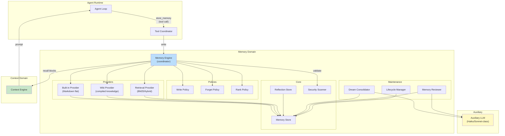
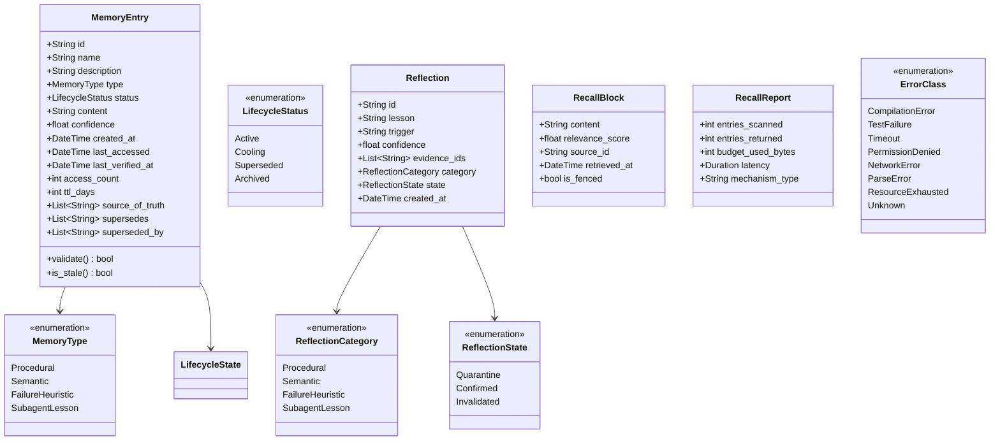
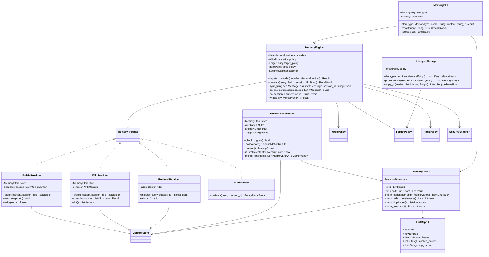
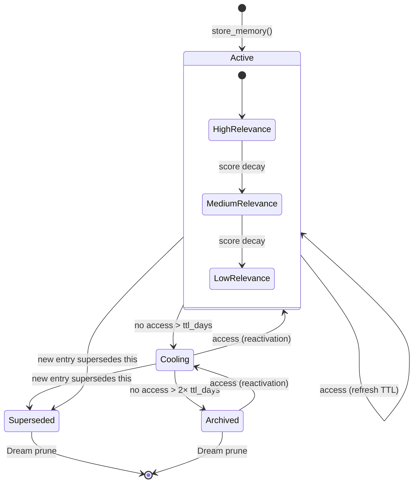
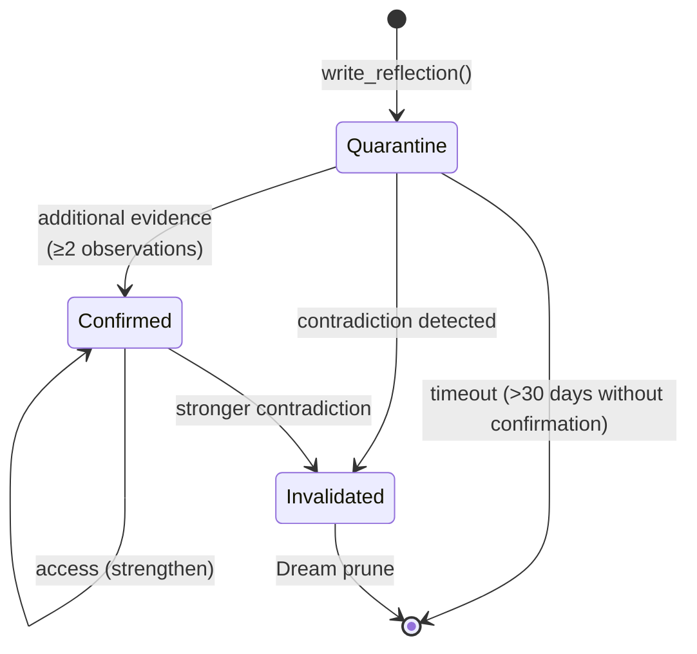
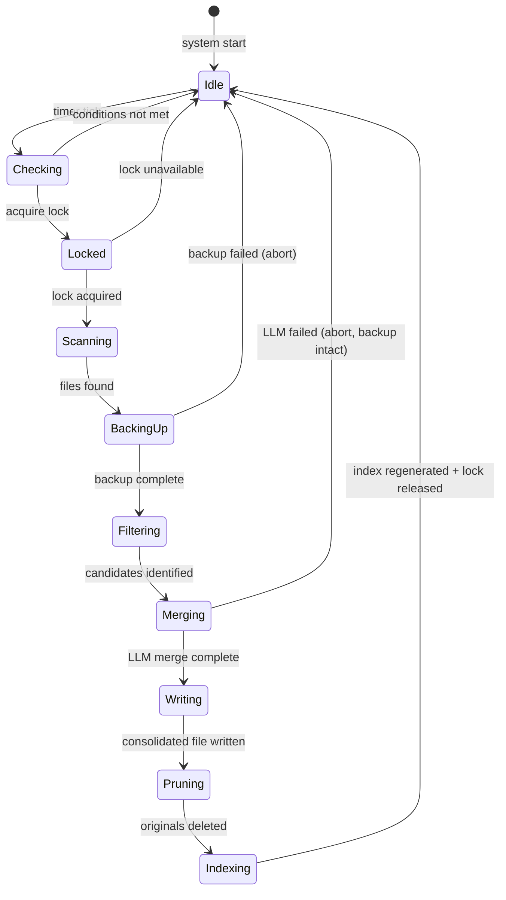
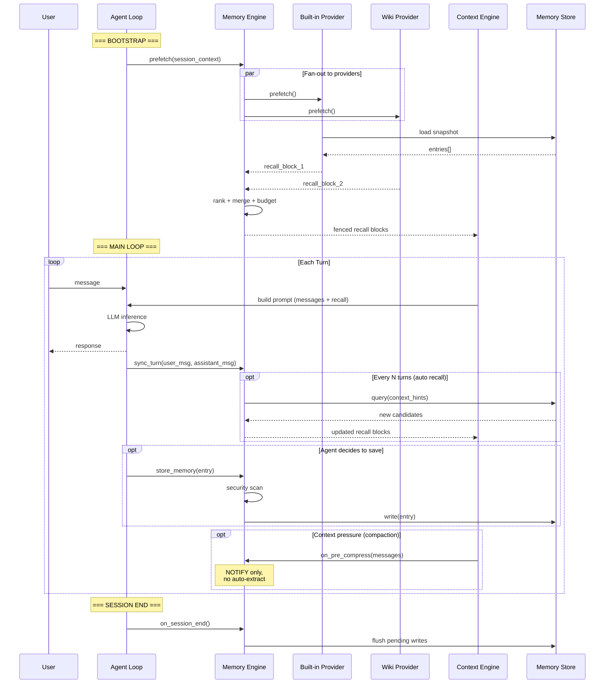
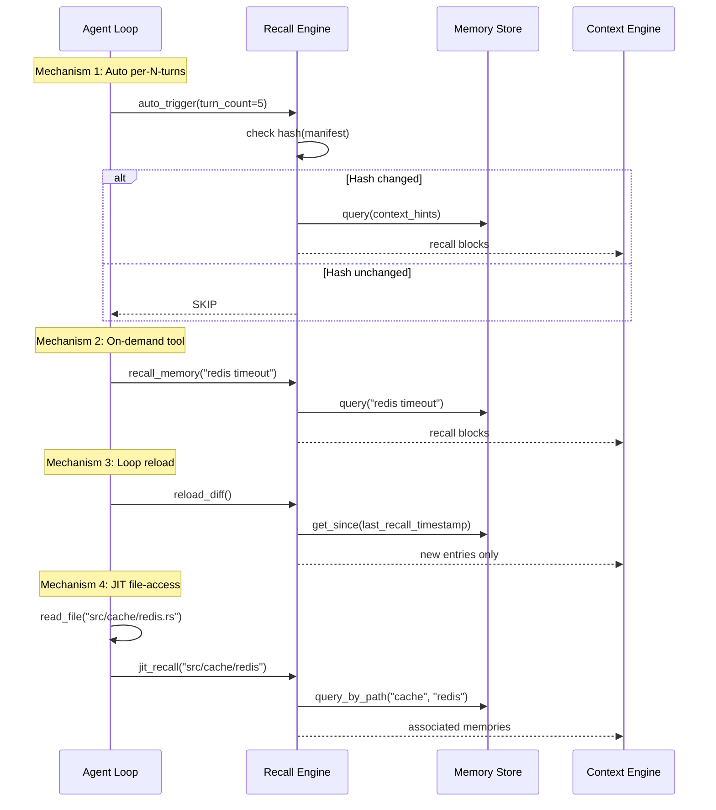
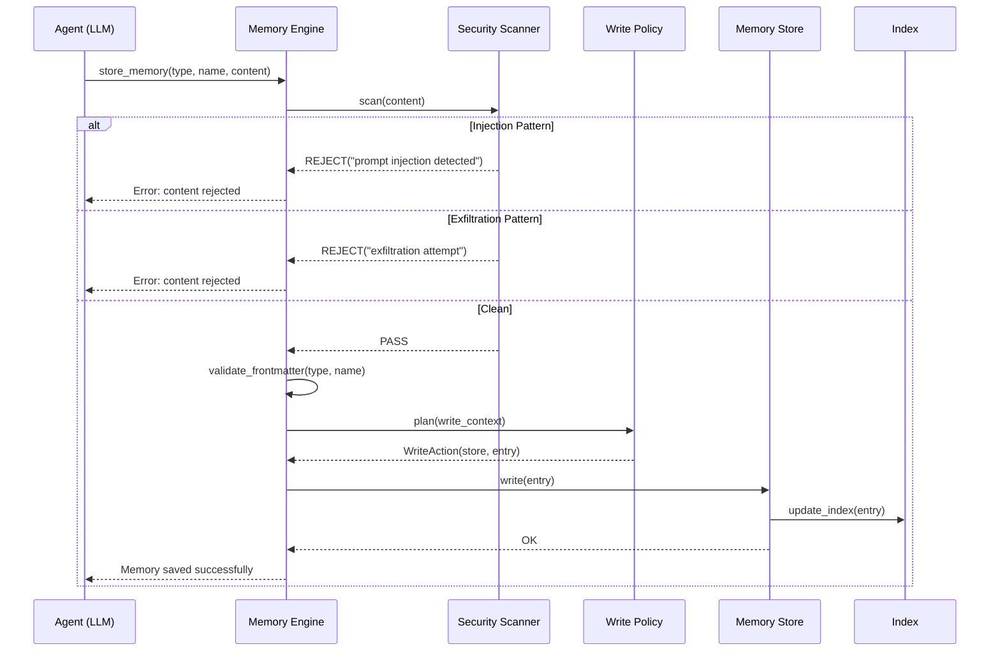

# Memory Systems — Reference Architecture

> **Version:** 2.0 — 2026-05-11
> **Based on:** cross-validation of 12 production implementations + 20+ academic papers + CoALA taxonomy (TMLR 2024) + production validation (Anthropic Dreaming, May 2026)
> **Scope:** Complete language-agnostic architecture of SOTA Memory Systems for code agents

---

## 1. Context

This document is the architectural reference of the Memory Systems module. It defines components, interfaces, flows, and invariants without reference to any specific language or implementation. The diagrams use UML (Mermaid) and can be mapped to any stack.

For the concepts and evidence behind each decision, consult the individual chapters:

| Chapter | Focus |
|---|---|
| [01_conceitos_fundamentais.md](01_conceitos_fundamentais.md) | Problem, taxonomy, invariants |
| [02_arquitetura.md](02_arquitetura.md) | Overview of the 5 components |
| [03_estrategias_escrita.md](03_estrategias_escrita.md) | Explicit vs automatic writes |
| [04_mecanismos_recall.md](04_mecanismos_recall.md) | 4 recall mechanisms |
| [05_consolidacao_dream.md](05_consolidacao_dream.md) | Dream consolidation |
| [06_llm_auxiliar.md](06_llm_auxiliar.md) | Tiered model system |
| [07_seguranca.md](07_seguranca.md) | Threat model and defenses |
| [08_fronteira.md](08_fronteira.md) | Emerging paradigms |

---

## 2. Component Diagram (C4 Level 2)

---

## 3. Class Diagram

### 3.1 Core Interfaces

```mermaid
classDiagram
    class MemoryProvider {
        <<interface>>
        +prefetch(query: String, session_id: String) RecallBlock
        +sync_turn(user_msg: Message, assistant_msg: Message, session_id: String) void
        +on_pre_compress(messages: List~Message~) void
        +on_session_end(session_id: String) void
        +write_reflection(reflection: Reflection) Result
        +reflection_recall(query: String) List~Reflection~
        +failure_heuristic_recall(error_class: ErrorClass) List~Reflection~
        +promote_quarantined(id: String) Result
        +take_last_recall_report() RecallReport
    }
    
    class MemoryStore {
        <<interface>>
        +write(entry: MemoryEntry) Result
        +read(id: String) Optional~MemoryEntry~
        +query(filter: QueryFilter) List~MemoryEntry~
        +delete(id: String) Result
        +list_all() List~MemoryEntry~
        +backup(target_path: String) Result
        +count() int
    }
    
    class WritePolicy {
        <<interface>>
        +plan(context: WriteContext) List~WriteAction~
    }
    
    class ForgetPolicy {
        <<interface>>
        +plan(context: ForgetContext) List~ForgetAction~
    }
    
    class RankPolicy {
        <<interface>>
        +score(entries: List~MemoryEntry~, context: RankContext) List~ScoredEntry~
    }
    
    class SecurityScanner {
        <<interface>>
        +scan(content: String) ScanResult
        +is_safe(entry: MemoryEntry) bool
    }
```

### 3.2 Data Types

### 3.3 Coordinator and Providers

---

## 4. State Diagrams

### 4.1 Memory Entry Lifecycle

**Superseded** is different from Archived: a superseded entry has been **replaced** by another more current one (via the `superseded_by` field). Recall ignores superseded entries. Dream removes them in the next cycle.

### 4.2 Reflection Lifecycle

### 4.3 Dream Consolidation States

---

## 5. Sequence Diagrams

### 5.1 Complete Session Lifecycle

### 5.2 Recall with 4 Mechanisms

### 5.3 Write with Security Scan

---

## 6. Architectural Invariants

| # | Invariant | Consequence |
|---|---|---|
| **I1** | Memory → Context (unidirectional) | Context Engine NEVER writes to Memory |
| **I2** | Explicit writes | Only the agent (LLM) decides what to persist |
| **I3** | No embeddings | Recall uses substring, Jaccard, BM25 — never dense vectors |
| **I4** | Compaction does not persist to Memory | Summaries are ephemeral, do not enter the memory store |
| **I5** | Atomic types protected | user, feedback, reference NEVER consolidated |
| **I6** | Backup before mutation | Dream NEVER modifies without prior backup |
| **I7** | Error isolation | Provider failure does not crash the agent loop |
| **I8** | Frozen snapshot | System prompt memory does not change mid-session |
| **I9** | Recall budget | Recall never exceeds cumulative budget (60KB default) |
| **I10** | Auxiliary model for volume | Compaction and selection use cheap model, not main |
| **I11** | Index is router, not memory | Index is injected at bootstrap; payloads are lazy-loaded on demand |
| **I12** | Do not duplicate sources of truth | Anything code, Git, tests, or docs prove should not be saved as memory |

---

## 7. Governing ADRs

| ADR | Title | Chapter |
|---|---|---|
| **ADR-01** | No Embeddings — Recall by Substring + Relevance Score | [Ch. 04](04_mecanismos_recall.md) |
| **ADR-02** | Explicit (Agent-Driven) Writes, Not Automatic | [Ch. 03](03_estrategias_escrita.md) |
| **ADR-09** | Pre-Compaction Hook (Notify, Not Extract) | [Ch. 03](03_estrategias_escrita.md) |
| **ADR-11** | Auxiliary LLM — Cheap Model for Volume | [Ch. 06](06_llm_auxiliar.md) |
| **ADR-14** | Dream Consolidation with Atomic Types Protection | [Ch. 05](05_consolidacao_dream.md) |
| **ADR-15** | Recall Frequency — 4 Complementary Mechanisms | [Ch. 04](04_mecanismos_recall.md) |

---

## 8. Comparative of Approaches (Industry)

| Dimension | Explicit Write | Automatic Write | Hybrid Write |
|---|---|---|---|
| **Write strategy** | Agent tool call | Heuristic extraction | Agent + inbox approval |
| **Categories** | 4-5 typed types | 0-1 (flat) | 3-4 (hierarchical) |
| **Recall** | Multi-mechanism + budget | Sequential/full dump | File-system glob + JIT |
| **Consolidation** | Automatic Dream | Manual/none | Auto + inbox |
| **Security** | Threat scan + fence + frozen | None/minimal | Approval gate |
| **Auxiliary LLM** | Tiered (cheap/intermediate) | Tiered | Background |

| Dimension | Markdown Store | SQLite Store | Knowledge Graph |
|---|---|---|---|
| **Human-readable** | Yes | No | Partial |
| **Git-friendly** | Yes | No | No |
| **Query power** | Low (substring) | High (SQL) | High (traversal) |
| **Infrastructure** | None | SQLite runtime | Graph DB |
| **Scalability** | Hundreds of entries | Thousands | Thousands+ |

---

## 9. References

| Paper | Venue | Contribution to the architecture |
|---|---|---|
| CoALA (arXiv:2309.02427) | TMLR 2024 | Base taxonomy: 4 memory types |
| MemGPT (arXiv:2310.08560) | 2023 | Agent-driven paging — the agent manages its own memory |
| The Memory Curse (arXiv:2605.08060) | 2026 | Controlled volume is essential — indiscriminate recall degrades |
| MemMachine (arXiv:2604.04853) | 2026 | Summaries + raw episodes > summaries-only |
| Anthropic Dreaming | Production, May 2026 | Dream consolidation validated with 6x improvement |
| MemoryBank (arXiv:2305.10250) | AAAI 2024 | Forgetting curve for lifecycle management |
| ERL (arXiv:2603.24639) | 2026 | Failure heuristics > success heuristics |
| Storage→Experience (arXiv:2605.06716) | 2026 | Evolutionary maturity taxonomy |
