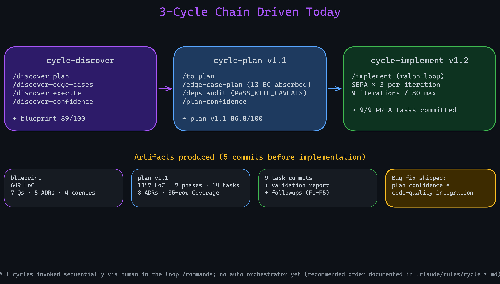
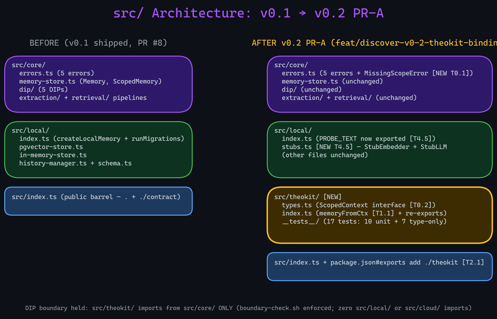
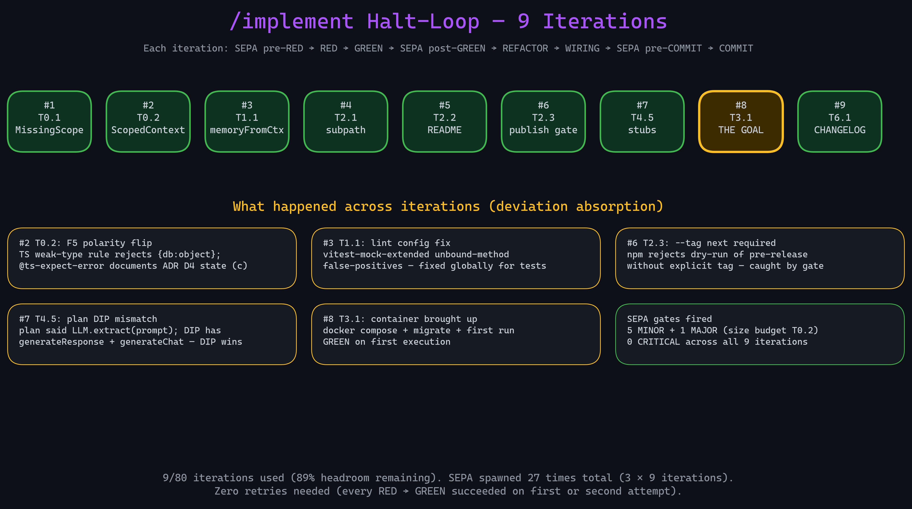
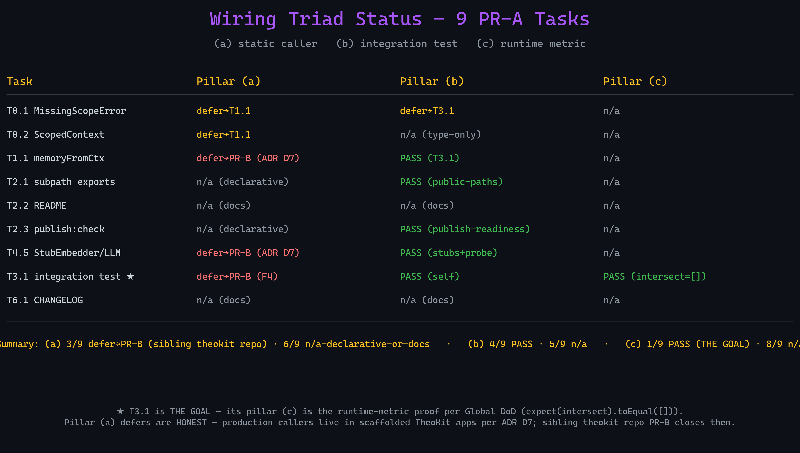
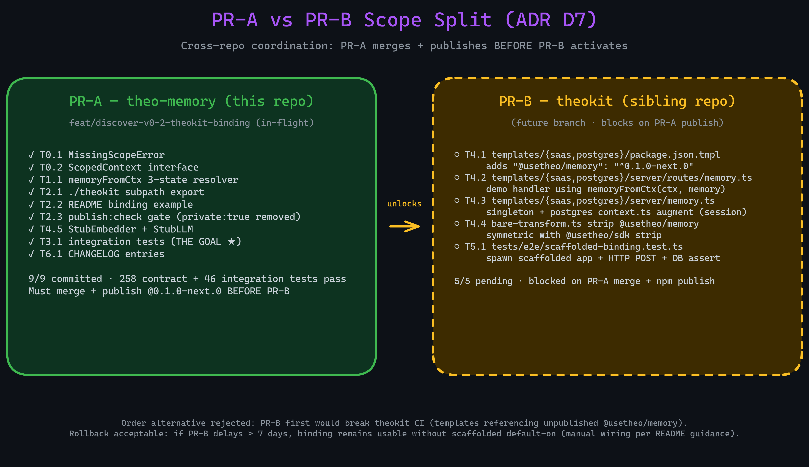

<style>
section {
  background-color: #0d1117;
  color: #c9d1d9;
  font-family: 'JetBrains Mono', 'Fira Code', 'Cascadia Code', monospace;
  font-size: 24px;
  padding: 50px 60px;
}
h1 {
  color: #a855f7;
  font-size: 38px;
  font-weight: 700;
  margin-bottom: 24px;
}
h2 {
  color: #c4b5fd;
  font-size: 30px;
  font-weight: 600;
  margin-bottom: 20px;
}
h3 {
  color: #d2a8ff;
  font-size: 26px;
  font-weight: 600;
}
ul, ol { margin-left: 10px; line-height: 1.9; }
li { margin-bottom: 6px; }
li::marker { color: #a855f7; }
code {
  background-color: #161b22;
  color: #c4b5fd;
  padding: 2px 8px;
  border-radius: 4px;
  font-size: 22px;
  border: 1px solid #30363d;
}
pre {
  background-color: #161b22;
  color: #c9d1d9;
  padding: 20px;
  border-radius: 8px;
  border: 1px solid #30363d;
  font-size: 20px;
}
pre code { border: none; padding: 0; background: transparent; }
strong { color: #fbbf24; font-weight: 700; }
em { color: #d2a8ff; font-style: italic; }
blockquote {
  border-left: 4px solid #a855f7;
  background-color: #161b22;
  color: #8b949e;
  padding: 12px 20px;
  margin: 16px 0;
  font-style: italic;
}
table {
  border-collapse: collapse;
  font-size: 20px;
  margin: 8px auto;
}
th {
  background-color: #161b22;
  color: #a855f7;
  border: 1px solid #30363d;
  padding: 6px 12px;
}
td { border: 1px solid #30363d; padding: 6px 12px; }
section.lead { text-align: center; }
section.lead h1 { font-size: 54px; }
section.lead h2 { font-size: 32px; color: #8b949e; }
img { display: block; margin: 0 auto; }
footer { color: #484f58; font-size: 14px; }
</style>

<!-- _class: lead -->

# TheMemory v0.2 PR-A

## Status Report — 2026-05-23

*Pre-release · feat/discover-v0-2-theokit-binding · in-flight*

---

# Onde estávamos antes

**Baseline:** v0.1 local runtime shipped (PR #8, 2026-05-23)

- 8-phase write pipeline + 9-step search
- Postgres + pgvector + Drizzle ORM
- Two `VectorStore` adapters (in-memory + pgvector)
- `createMemory({vectorStore, embedder, llm})` working end-to-end
- 226 contract + 28 integration tests passing

**The ergonomics gap:** every TheoKit handler had to call `memory.user(ctx.session.userId).remember(text)` explicitly — two lookups per call, threaded singleton

> v0.2 PR-A closes this gap

---

# A chain de 3 ciclos que dirigimos hoje



---

# Arquitetura: antes vs depois



---

# cycle-discover output

**Blueprint** `v0-2-theokit-binding-blueprint.md` (649 LoC)

- **7 questions** investigated across `referencia/mem0`, `referencia/letta`, `../theokit/`
- **5 ADRs** synthesized (D1 structural typing, D2 arg-passed, D3 default-on, D4 3-state resolver, D5 test pyramid)
- **4 coverage corners** populated (tests/deps/tools/techniques)
- **Verdict:** SHIPPABLE_WITH_CAVEATS **89/100**
- Only cap fired: `soft_floor_citation_density_low` (text-heavy synthesis)

**Key findings:** zero AsyncLocalStorage in TheoKit; `defineRoute<TCtx = unknown>` makes structural typing the right shape; create-theo is static-template scaffolder

---

# cycle-plan output

**Plan** `v0-2-theokit-binding-plan.md` v1.1 (1347 LoC)

- 7 phases · 14 tasks · **8 ADRs** · 35-row Coverage Matrix at **100%**
- `/edge-case-plan`: 5 MUST FIX + 5 SHOULD TEST + 3 DOCUMENT — **all absorbed v1.0→v1.1**
- `/deps-audit`: PASS_WITH_CAVEATS (0 CRIT/HIGH CVE; 4 MODERATE allowlisted)
- `/plan-confidence`: SHIPPABLE_WITH_CAVEATS **86.8/100**

**Bug fix shipped mid-cycle:** `_merge_code_quality_verdict()` extracted + 5 regression tests — plan-confidence was capping at 49 INVALID for any allowlist-downgraded code-quality finding (neutralized allowlist mechanism)

---

# /implement halt-loop — 9 iterations



---

# THE GOAL — isolation verificada

```typescript
// tests/integration/theokit-binding.test.ts
test('two distinct userIds produce disjoint recall result sets (ZERO overlap)', async () => {
  await memoryFromCtx({session:{userId:'alice'}}, memory).remember('Alice secret');
  await memoryFromCtx({session:{userId:'bob'  }}, memory).remember('Bob secret');

  const aliceResults = await memory.user('alice').recall('secret');
  const bobResults   = await memory.user('bob').recall('secret');

  const aliceIds = new Set(aliceResults.map((r) => r.id));
  const intersect = bobResults.filter((r) => aliceIds.has(r.id));

  expect(intersect).toEqual([]);  // ✓ runtime-metric proof per Global DoD
});
```

---

# 9 PR-A tasks shipped

| Task | SHA | Wiring (a/b/c) |
|---|---|---|
| T0.1 MissingScopeError | `b91738a` | defer / defer / n-a |
| T0.2 ScopedContext | `59063ba` | defer / n-a / n-a |
| T1.1 memoryFromCtx | `837d0b9` | defer-PR-B / pass / n-a |
| T2.1 ./theokit subpath | `2b65054` | n-a / pass / n-a |
| T2.2 README example | `1c9797f` | n-a / n-a / n-a |
| T2.3 publish:check | `04766d1` | n-a / pass / n-a |
| T4.5 Stub adapters | `3212e2e` | defer-PR-B / pass / n-a |
| T3.1 integration test ★ | `b6ca7ed` | defer / pass / **PASS** |
| T6.1 CHANGELOG | `29a3afc` | n-a / n-a / n-a |

---

# Wiring triad status



---

# PR-A vs PR-B (ADR D7)



---

# O que ficou deferido

**PR-B (sibling theokit repo) — 5 tasks pending:**
- T4.1 templates `package.json.tmpl` (dep declaration)
- T4.2 demo route `server/routes/memory.ts`
- T4.3 singleton `server/memory.ts` + postgres context augment
- T4.4 `bare-transform.ts` strip symmetry
- T5.1 E2E test (scaffolded app + HTTP + DB assert)

**Followup F2:** real-embedder probe parity — deferido para PR-B (scaffolded handler é o real-embedder integration surface)

**Followups F3/F4/F5/F1:** absorvidos durante o halt-loop (test fixture isolation, wiring DEFER discipline, empty-scope usability, publish-readiness positive inclusion)

---

# Próximos passos

1. **`/review v0-2-theokit-binding`** — spawn 5-7 specialized review agents (architecture / tests / wiring / cross-validation + 1-3 domain-specific). Cost: ~60k (split mode) or 150-250k (fallback)
2. **PR-A** — abrir PR + revisão humana
3. **Merge** → mover `plans/v0-2-theokit-binding-plan.md` para `plans/completed/` (audit-trail-rotation.md)
4. **Publish** `@usetheo/memory@0.1.0-next.0` via `npm publish --tag next`
5. **PR-B kickoff** — sibling theokit repo: T4.1-T4.4 + T5.1
6. **Roadmap update** — flip Item 3 status `Planned` → `Shipped (PR-A)` (post-merge commit; padrão v0.1)

---

<!-- _class: lead -->

# Status honesto

**v0.2 PR-A in-flight** — 9/9 tasks committed
**258 contract + 46 integration tests pass**
**THE GOAL metric verified** (`intersect.toEqual([])`)

*Pre-release · v1.0 production claim still gated by /dogfood · PR-B coordinated per ADR D7*

> Honest BLOCKED > false completion (Inquebrável Rule 3)
